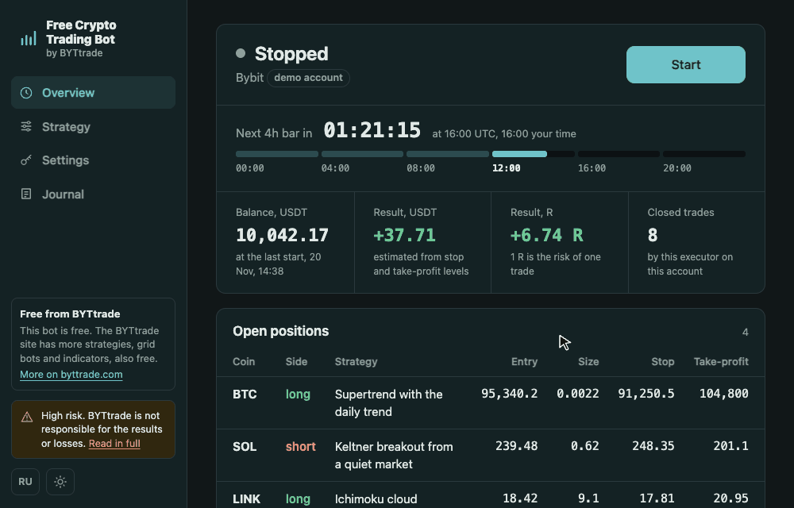
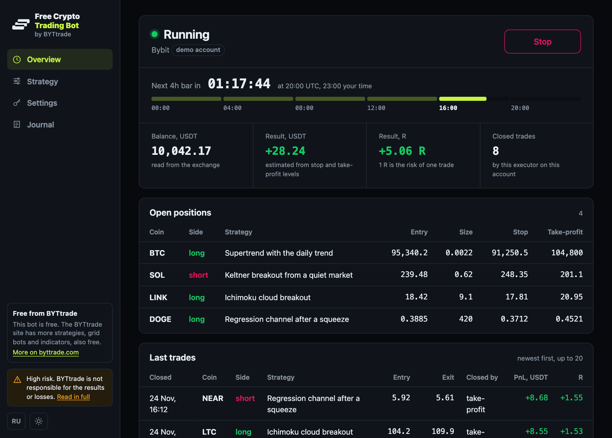
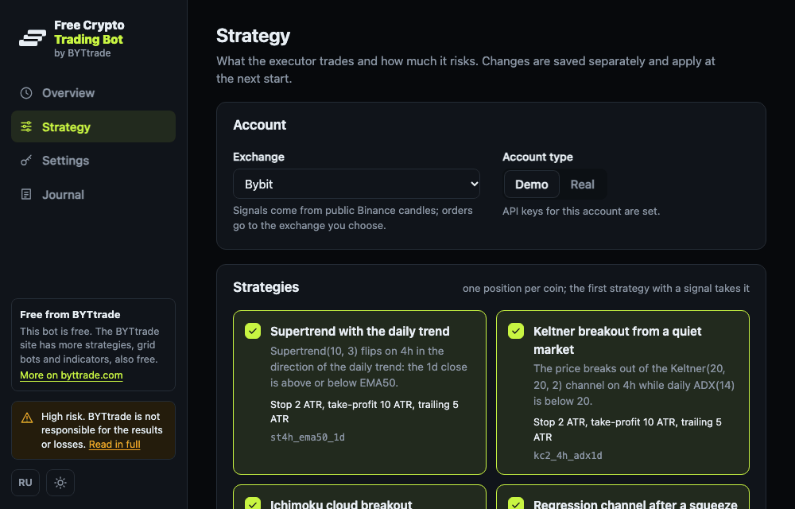
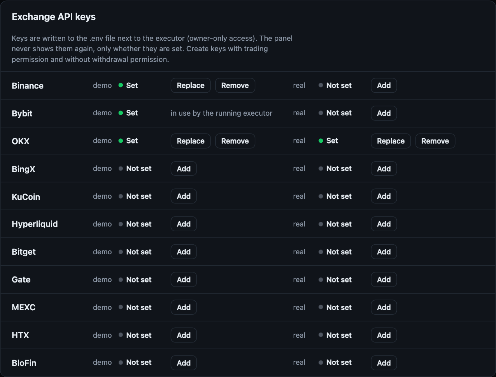
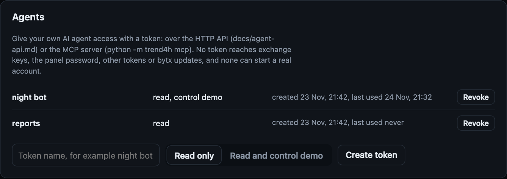
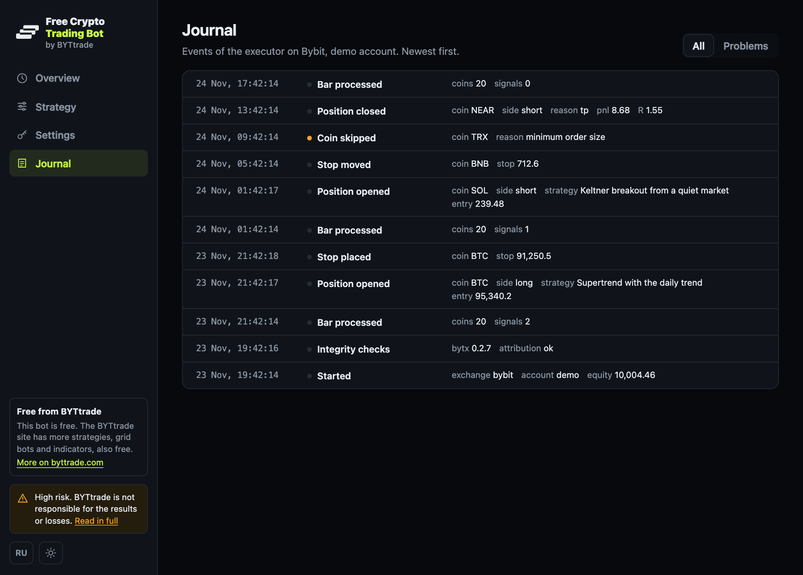
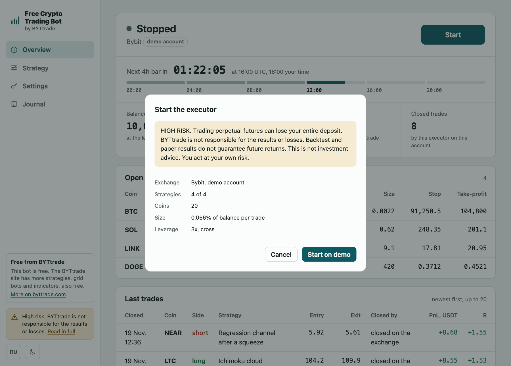
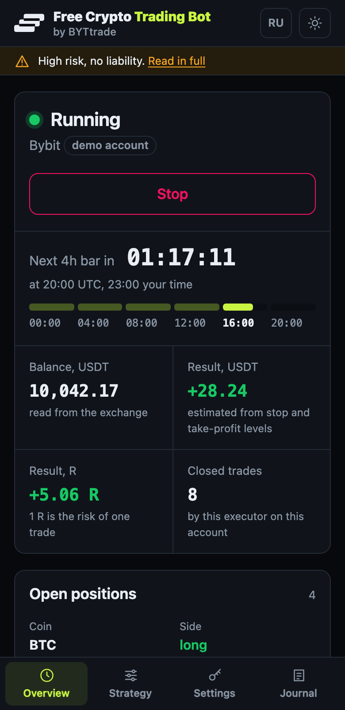
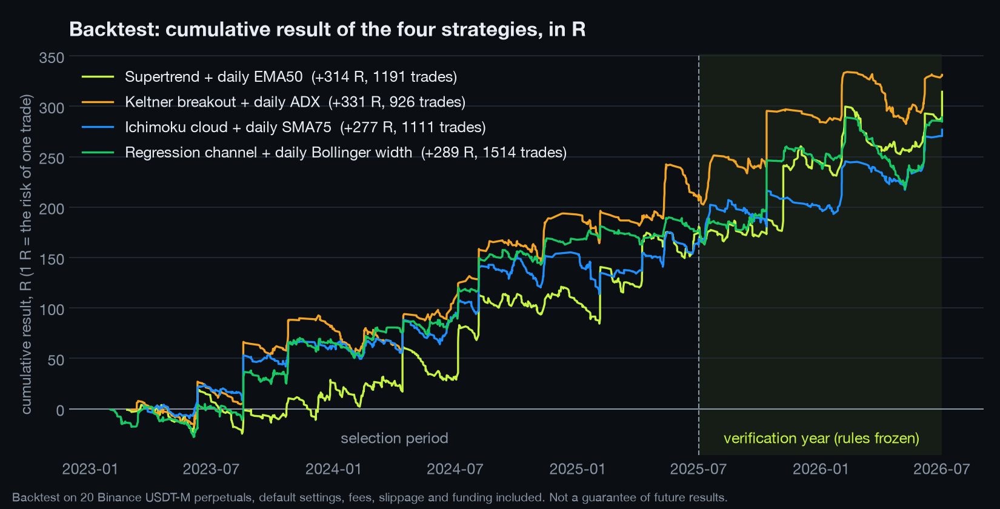
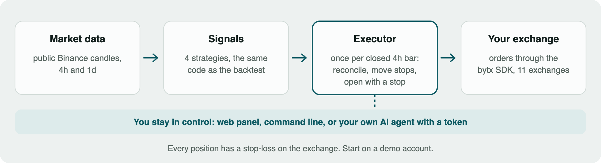

<h1 align="center">Free Crypto Trading Bot by BYTtrade</h1>

<p align="center">
Four backtested 4h trend-following strategies for crypto futures, an open backtest you can re-run yourself,<br>
a web panel and 11 exchanges. Free.
</p>

<p align="center">

<a href="https://pypi.org/project/free-crypto-trading-bot/"></a>
<a href="https://github.com/byttrade/free-crypto-trading-bot/actions/workflows/tests.yml"></a>


</p>

<p align="center">
<a href="https://github.com/byttrade/free-crypto-trading-bot/blob/main/README.ru.md">Русская версия</a> ·
<a href="https://github.com/byttrade/free-crypto-trading-bot/blob/main/docs/guide.md">Guide</a> ·
<a href="https://github.com/byttrade/free-crypto-trading-bot/blob/main/docs/research.md">Research</a> ·
<a href="https://github.com/byttrade/free-crypto-trading-bot/blob/main/docs/agent-api.md">Agent API</a>
</p>

> **Risk warning and disclaimer.** This is high-risk trading: perpetual futures can lose your entire deposit.
> BYTtrade is not responsible for the results you get or for any losses. Backtest and paper-trading results do not
> guarantee future returns. Nothing here is investment advice. You act at your own risk.
> The software comes without any warranty; see sections 8 and 9 of the [LICENSE](https://github.com/byttrade/free-crypto-trading-bot/blob/main/LICENSE).

**Status: research.** The numbers below are a backtest. No real-money track record exists.

<p align="center"></p>
<p align="center"><sub>The panel with demo data: every balance, position and trade in the pictures on this page is invented.</sub></p>

## What it is and who it is for

- 📈 **Four strategies with an open backtest.** Trend following on 4h candles for 20 large coins, tested on
  3.5 years of history with fees, slippage and funding. Two commands recompute the results table below on your computer.
- 🖥️ **A web panel instead of a config file.** Start and stop, positions, trades, settings and exchange keys in the
  browser, on a phone too, in English and Russian.
- 🛡️ **Built to limit damage.** Every position gets a stop-loss on the exchange, an order is never sent twice, and
  a real account starts only after you type a confirmation phrase.
- 🔌 **11 exchanges, demo first.** Binance, Bybit, OKX, BingX, KuCoin, Hyperliquid, Bitget, Gate, MEXC, HTX, BloFin.
  Start on a demo account where the exchange has one.
- 💸 **Free.** No subscription and no paid tier. How BYTtrade earns is explained [in the guide](https://github.com/byttrade/free-crypto-trading-bot/blob/main/docs/guide.md#faq).

It is for people who want to try systematic trading on a demo account and check a backtest themselves. It is not
for anyone who expects a guaranteed income: read [the limitations](#honest-limitations) first.

## Install and start

**pip** (Python 3.10+), or **uvx** without installing anything:

```bash
pip install 'free-crypto-trading-bot[live]'
free-crypto-trading-bot panel          # open http://127.0.0.1:8790

uvx --from 'free-crypto-trading-bot[live]' free-crypto-trading-bot panel
```

**Docker:**

```bash
curl -O https://raw.githubusercontent.com/byttrade/free-crypto-trading-bot/main/docker-compose.yml
docker compose run --rm bot panel-user     # once: the login of the panel
docker compose up -d                       # open http://127.0.0.1:8790
```

**From source:**

```bash
git clone https://github.com/byttrade/free-crypto-trading-bot && cd free-crypto-trading-bot
pip install -e '.[live]'
python -m trend4h panel
```

In the panel: add the API keys of a **demo** account in Settings, look through Strategy, press Start. The
[guide](https://github.com/byttrade/free-crypto-trading-bot/blob/main/docs/guide.md) covers every step, from creating keys to Docker and running on a server.

The command has three names that do the same: `free-crypto-trading-bot`, `trend4h` and `python -m trend4h`.
`trend4h` is the internal name of the project: the Python package and the name the LICENSE uses. Keys, settings,
state and downloaded data are kept in the folder you run the command from.

Only want the backtest? No keys and no account are needed:

```bash
pip install free-crypto-trading-bot
free-crypto-trading-bot fetch          # public Binance data, about 3 minutes, 11 MB
free-crypto-trading-bot report         # all four strategies on both periods
```

## The panel

| Overview | Strategy |
|---|---|
|  |  |
| State, time to the next 4h bar, balance, result, open positions and last trades. | Strategies, coins, position size, limits. The panel says so when the settings differ from the research. |

| Exchange keys | Your AI agents |
|---|---|
|  |  |
| Keys go to `.env` on your machine and are never shown again. | Tokens with read or demo-control rights. |

| Journal | Start dialog | On a phone |
|---|---|---|
|  |  |  |

<sub>Demo data in every picture.</sub>

## Backtest results

20 large Binance USDT-M perpetuals, 4h and 1d candles. Rules were searched on 2023-01-01 … 2025-06-30 (selection)
and frozen for 2025-07-01 … 2026-06-30 (verification). PF is gross profit over gross loss; Σ R is the total result
in units of risk per trade; drawdown is in % of capital at 1 % risk per trade.

| Strategy | Period | Trades | PF | Σ R | Drawdown, % |
|---|---|---|---|---|---|
| Supertrend + daily EMA50 (`st4h_ema50_1d`) | selection | 839 | 1.33 | +180.6 | 41 |
| | verification | 352 | 1.59 | +133.8 | 50 |
| Keltner breakout + daily ADX (`kc2_4h_adx1d`) | selection | 660 | 1.53 | +212.0 | 39 |
| | verification | 266 | 1.74 | +119.2 | 51 |
| Ichimoku cloud + daily SMA75 (`zmid1d_cloud4h`) | selection | 793 | 1.41 | +168.4 | 42 |
| | verification | 318 | 1.70 | +108.4 | 35 |
| Regression channel + daily Bollinger width (`bbw1d_lr4h`) | selection | 1 048 | 1.41 | +177.8 | 25 |
| | verification | 466 | 1.53 | +111.4 | 69 |

<p align="center"></p>
<p align="center"><sub>A backtest, not a guarantee. The drawdowns are large: see the limitations below.</sub></p>

Test conditions, costs, execution rules, the third period, parameter stability, controls without filters and
reproducibility are in [docs/research.md](https://github.com/byttrade/free-crypto-trading-bot/blob/main/docs/research.md). The raw tables are in [results/](https://github.com/byttrade/free-crypto-trading-bot/tree/main/results).

## How it works

<p align="center"></p>

- Once per closed 4h bar the executor computes the signals with the same code as the backtest, on public Binance
  candles, whatever exchange you trade on.
- It enters with a market order sized by risk and places the stop-loss on the exchange together with the entry.
  If the stop cannot be placed, the position is closed.
- It never re-sends an order after a timeout: the outcome is looked up on the exchange.
- It holds one position per coin and does not touch positions it did not open.
- State and a journal are kept in local files, so a restart continues where it stopped.

Details: [what the executor does step by step](https://github.com/byttrade/free-crypto-trading-bot/blob/main/docs/guide.md#what-the-executor-does-step-by-step).

## Exchanges

Binance, Bybit, OKX, BingX, KuCoin, Hyperliquid, Bitget, Gate, MEXC, HTX and BloFin, through the
[bytx](https://github.com/byttrade/bytx) SDK. Demo accounts work on Binance, Bybit, OKX, BingX, Hyperliquid, Bitget,
Gate and BloFin; KuCoin, MEXC and HTX have no demo environment. See [exchange keys](https://github.com/byttrade/free-crypto-trading-bot/blob/main/docs/guide.md#exchange-keys).

## Your own AI agent

Create a token in the panel and give it to your agent: over the HTTP API or the built-in MCP server. Agents and assistants start with [AGENTS.md](https://github.com/byttrade/free-crypto-trading-bot/blob/main/AGENTS.md); there is also a [skill file](https://github.com/byttrade/free-crypto-trading-bot/blob/main/skills/free-crypto-trading-bot/SKILL.md), [llms.txt](https://github.com/byttrade/free-crypto-trading-bot/blob/main/llms.txt) and an MCP registry entry ([server.json](https://github.com/byttrade/free-crypto-trading-bot/blob/main/server.json)). A token can
read the state and, if you allow it, control the executor on the demo account. It never reaches exchange keys and
cannot start a real account. An agent works through these public interfaces and does not change the code, which
is what the license allows ("you may add, you may not modify"). See [docs/agent-api.md](https://github.com/byttrade/free-crypto-trading-bot/blob/main/docs/agent-api.md) and
[the guide](https://github.com/byttrade/free-crypto-trading-bot/blob/main/docs/guide.md#agents).

## Honest limitations

- **One idea, not four.** The strategies correlate (0.47–0.80), so drawdowns come together.
- **It does not work outside the twenty coins.** On 639 other perpetuals the result was close to zero.
- **Shorts were stronger than longs.** The market of the verification year was falling.
- **Multiple testing.** The four strategies were chosen from about 3 000 variants; part of the result is
  hindsight. The control without filters (PF 1.2–1.3) is closer to an honest estimate.
- **Live differs from the backtest.** One position per coin, simplified execution model, no modelling of
  liquidation or exchange outages.

All eight points with numbers: [docs/research.md](https://github.com/byttrade/free-crypto-trading-bot/blob/main/docs/research.md#honest-limitations).

## Documentation

| Document | What is inside |
|---|---|
| [docs/guide.md](https://github.com/byttrade/free-crypto-trading-bot/blob/main/docs/guide.md) | installation, backtest, settings, keys, start, the panel, a server, agents, errors, FAQ |
| [docs/research.md](https://github.com/byttrade/free-crypto-trading-bot/blob/main/docs/research.md) | test conditions, full results, controls, reproducibility, limitations |
| [docs/agent-api.md](https://github.com/byttrade/free-crypto-trading-bot/blob/main/docs/agent-api.md) | HTTP API and MCP server for your own agent |
| [AGENTS.md](https://github.com/byttrade/free-crypto-trading-bot/blob/main/AGENTS.md) | instructions for AI agents: what they may do for you and what they must not |
| [CHANGELOG.md](https://github.com/byttrade/free-crypto-trading-bot/blob/main/CHANGELOG.md) | what changed in each release |
| [results/](https://github.com/byttrade/free-crypto-trading-bot/tree/main/results) | metrics recomputed by this code and recorded research tables |

## License

[BYTtrade Source-Available License 1.3 (trend-4h edition)](https://github.com/byttrade/free-crypto-trading-bot/blob/main/LICENSE), the same terms as bytx. In plain words:

- **You may:** run it on your own computers and servers, trade with it, add your own strategy specs, configs and
  your own code next to it.
- **You may not:** modify the code of this project or of bytx; disable or replace the broker attribution or the
  integrity checks, including through settings and environment variables (section 3(g)); distribute modified
  versions; offer it to third parties as a service.

The LICENSE text is what counts; this summary does not replace it. Dependencies and their licenses: [NOTICE](https://github.com/byttrade/free-crypto-trading-bot/blob/main/NOTICE).

## BYTtrade

This bot is free and made by BYTtrade. On [byttrade.com](https://byttrade.com/?utm_source=github&utm_medium=free_tool&utm_campaign=free-crypto-trading-bot&utm_content=readme_en)
there are more strategies, grid bots, more indicators and a deeper history for backtests, with nothing to code by
hand, and a large community. That is free as well.

<!-- mcp-name: io.github.byttrade/free-crypto-trading-bot -->
