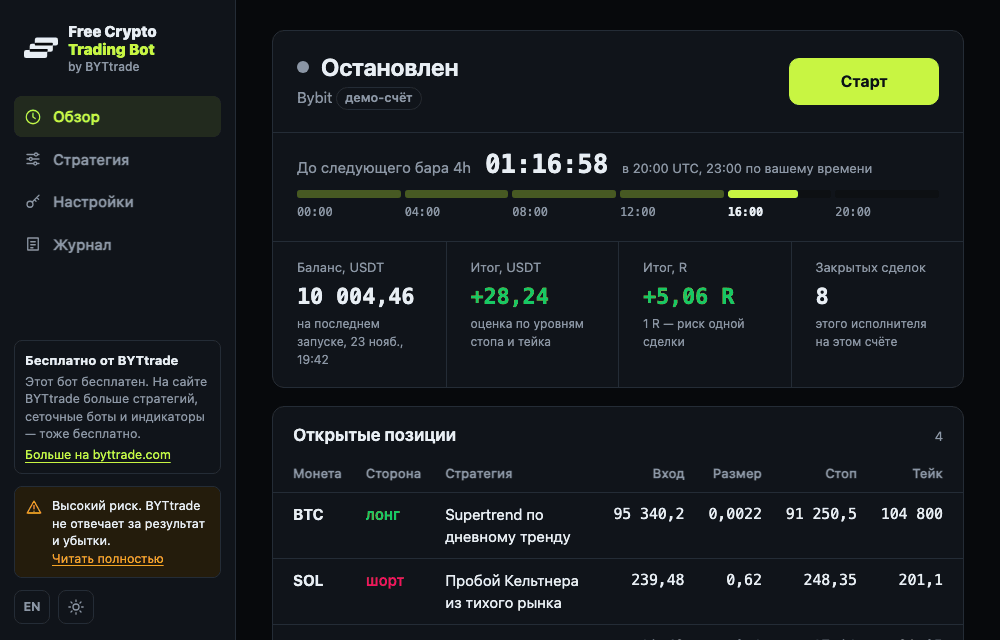
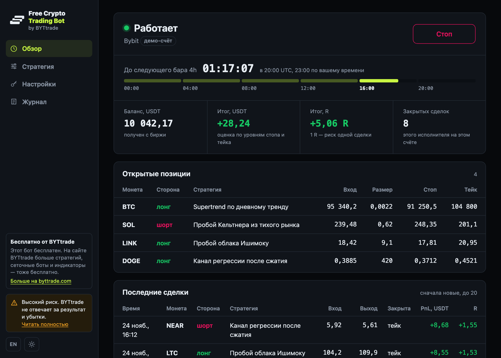
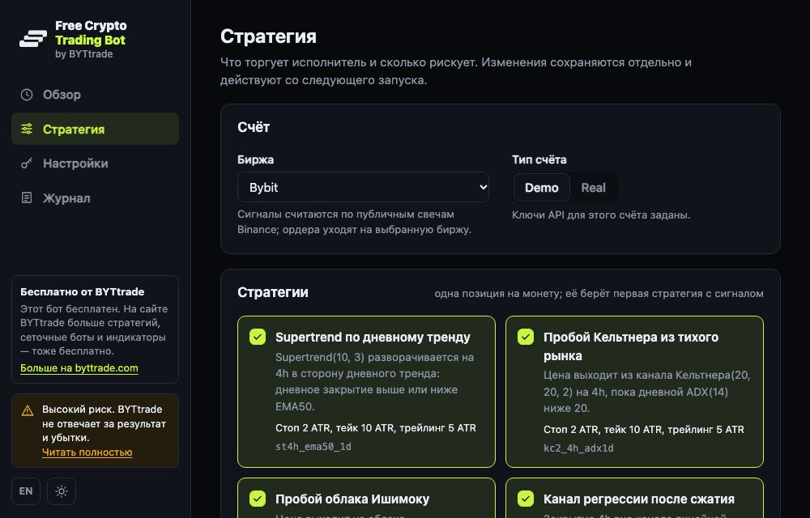
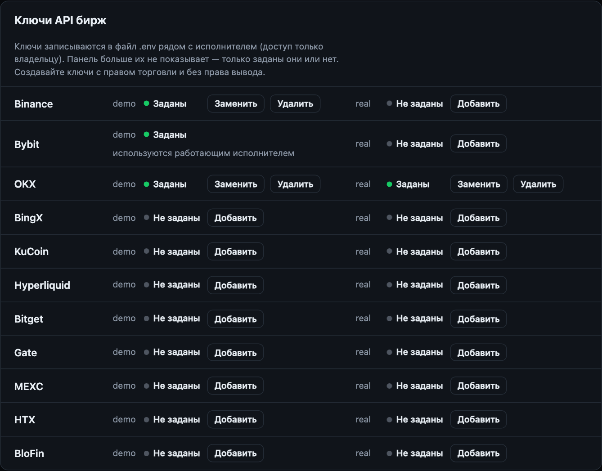
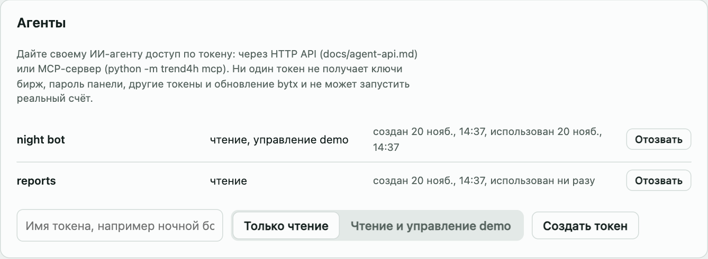
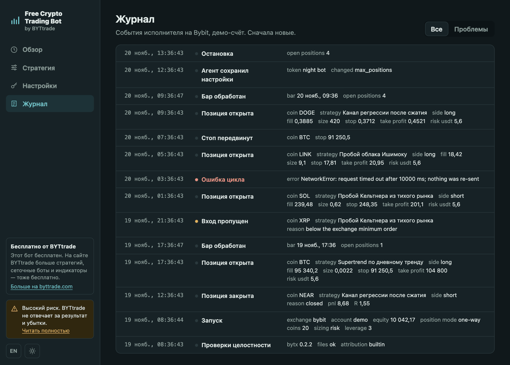
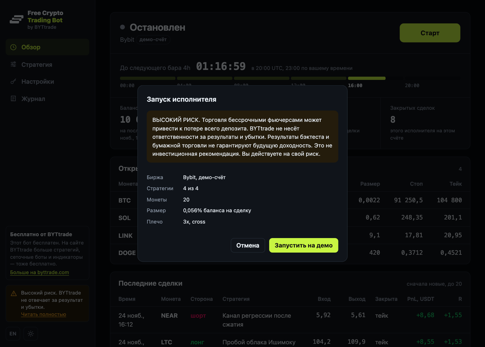
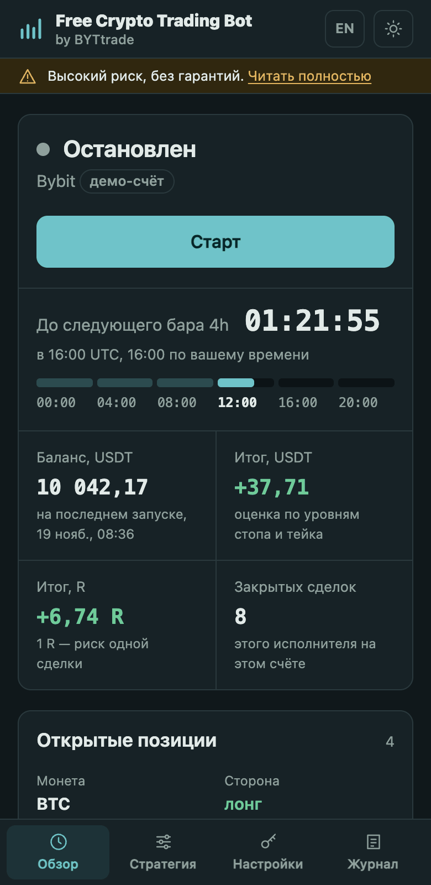
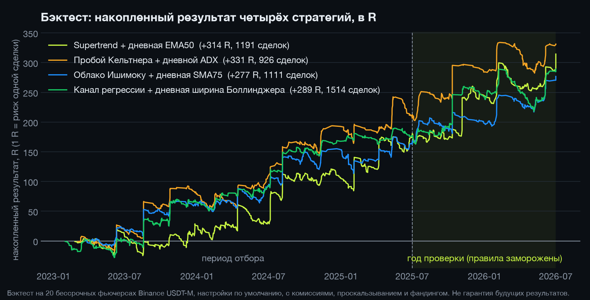
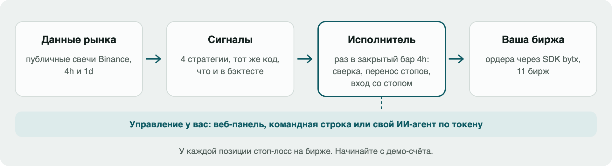

<h1 align="center">Бесплатный торговый бот для крипты от BYTtrade</h1>

<p align="center">
Четыре проверенные на истории стратегии трендследования 4h для крипто-фьючерсов, открытый бэктест, который можно<br>
пересчитать самому, веб-панель и 11 бирж. Бесплатно.
</p>

<p align="center">

<a href="https://pypi.org/project/free-crypto-trading-bot/"></a>
<a href="https://github.com/byttrade/free-crypto-trading-bot/actions/workflows/tests.yml"></a>


</p>

<p align="center">
<a href="README.md">English version</a> ·
<a href="docs/guide.ru.md">Руководство</a> ·
<a href="docs/research.ru.md">Исследование</a> ·
<a href="docs/agent-api.md">API для агентов</a>
</p>

> **Предупреждение о риске и отказ от ответственности.** Это высокорискованная торговля: на бессрочных фьючерсах
> можно потерять весь депозит. BYTtrade не несёт ответственности за полученные результаты и убытки. Результаты
> бэктеста и бумажной проверки не гарантируют будущей доходности. Это не инвестиционная рекомендация. Вы действуете
> на свой риск. Программа поставляется без каких-либо гарантий — см. разделы 8 и 9 [лицензии](LICENSE).

<p align="center"></p>
<p align="center"><sub>Панель с данными для примера: все балансы, позиции и сделки на картинках этой страницы вымышлены.</sub></p>

## Что это и для кого

- 📈 **Четыре стратегии с открытым бэктестом.** Трендследование на свечах 4h для 20 крупных монет, проверенное на
  3,5 годах истории с комиссиями, проскальзыванием и фандингом. Две команды пересчитывают таблицу результатов ниже на
  вашем компьютере.
- 🖥️ **Веб-панель вместо файла настроек.** Старт и стоп, позиции, сделки, настройки и ключи бирж — в браузере, в том
  числе на телефоне, на русском и английском.
- 🛡️ **Сделан так, чтобы ограничивать ущерб.** Каждая позиция получает стоп-лосс на бирже, ордер никогда не
  отправляется дважды, а реальный счёт запускается только после ввода фразы подтверждения.
- 🔌 **11 бирж, сначала демо.** Binance, Bybit, OKX, BingX, KuCoin, Hyperliquid, Bitget, Gate, MEXC, HTX, BloFin.
  Начинайте с демо-счёта там, где он у биржи есть.
- 💸 **Бесплатно.** Без подписки и платных тарифов.

Бот для тех, кто хочет попробовать системную торговлю на демо-счёте и сам проверить бэктест. Он не для тех, кто
ждёт гарантированного дохода: сначала прочитайте [ограничения](#честные-ограничения).

## Установка и запуск

**pip** (Python 3.10+) или **uvx** — без установки:

```bash
pip install 'free-crypto-trading-bot[live]'
free-crypto-trading-bot panel          # откройте http://127.0.0.1:8790

uvx --from 'free-crypto-trading-bot[live]' free-crypto-trading-bot panel
```

**Docker:**

```bash
curl -O https://raw.githubusercontent.com/byttrade/free-crypto-trading-bot/main/docker-compose.yml
docker compose run --rm bot panel-user     # один раз: логин панели
docker compose up -d                       # откройте http://127.0.0.1:8790
```

**Из исходников:**

```bash
git clone https://github.com/byttrade/free-crypto-trading-bot && cd free-crypto-trading-bot
pip install -e '.[live]'
python -m trend4h panel
```

В панели: добавьте ключи API **демо**-счёта в «Настройках», посмотрите «Стратегию», нажмите «Старт». Панель
открывается на английском; русский включается кнопкой RU. [Руководство](docs/guide.ru.md) описывает каждый шаг,
от создания ключей до Docker и работы на сервере.

У команды три имени, они делают одно и то же: `free-crypto-trading-bot`, `trend4h` и `python -m trend4h`.
`trend4h` — внутреннее имя проекта: так называются пакет Python и продукт в тексте LICENSE. Ключи, настройки,
состояние и скачанные данные хранятся в папке, из которой вы запускаете команду.

Нужен только бэктест? Ключи и счёт не требуются:

```bash
pip install free-crypto-trading-bot
free-crypto-trading-bot fetch          # публичные данные Binance, около 3 минут, 11 МБ
free-crypto-trading-bot report         # все четыре стратегии на обоих периодах
```

## Панель

| Обзор | Стратегия |
|---|---|
|  |  |
| Состояние, время до следующего бара 4h, баланс, итог, открытые позиции и последние сделки. | Стратегии, монеты, размер позиции, лимиты. Панель сообщает, когда настройки отличаются от исследовательских. |

| Ключи бирж | Свои ИИ-агенты |
|---|---|
|  |  |
| Ключи записываются в `.env` на вашей машине и больше не показываются. | Токены с правом чтения или управления демо-счётом. |

| Журнал | Диалог запуска | На телефоне |
|---|---|---|
|  |  |  |

<sub>На всех картинках данные для примера.</sub>

## Результаты бэктеста

20 крупных бессрочных контрактов Binance USDT-M, свечи 4h и 1d. Правила подбирались на 2023-01-01 … 2025-06-30
(отбор) и были заморожены на 2025-07-01 … 2026-06-30 (проверка). PF — валовая прибыль к валовому убытку; Σ R — итог
в единицах риска на сделку; просадка — в % капитала при риске 1 % на сделку.

| Стратегия | Период | Сделок | PF | Σ R | Просадка, % |
|---|---|---|---|---|---|
| Supertrend + дневная EMA50 (`st4h_ema50_1d`) | отбор | 839 | 1,33 | +180,6 | 41 |
| | проверка | 352 | 1,59 | +133,8 | 50 |
| Пробой Кельтнера + дневной ADX (`kc2_4h_adx1d`) | отбор | 660 | 1,53 | +212,0 | 39 |
| | проверка | 266 | 1,74 | +119,2 | 51 |
| Облако Ишимоку + дневная SMA75 (`zmid1d_cloud4h`) | отбор | 793 | 1,41 | +168,4 | 42 |
| | проверка | 318 | 1,70 | +108,4 | 35 |
| Канал регрессии + ширина дневного Боллинджера (`bbw1d_lr4h`) | отбор | 1 048 | 1,41 | +177,8 | 25 |
| | проверка | 466 | 1,53 | +111,4 | 69 |

<p align="center"></p>
<p align="center"><sub>Бэктест, не гарантия. Просадки большие: см. ограничения ниже.</sub></p>

Условия проверки, издержки, правила исполнения, третий период, устойчивость к параметрам, контроль без фильтров и
воспроизводимость — в [docs/research.ru.md](docs/research.ru.md). Исходные таблицы — в [results/](results/).

## Как это работает

<p align="center"></p>

- Раз на закрытии бара 4h исполнитель считает сигналы тем же кодом, что и бэктест, по публичным свечам Binance —
  на какой бы бирже вы ни торговали.
- Входит рыночным ордером с размером по риску и ставит стоп-лосс на бирже вместе со входом. Если стоп не встал,
  позиция закрывается.
- Не отправляет ордер повторно после таймаута: исход выясняется на бирже.
- Держит одну позицию на монету и не трогает позиции, которые открыл не он.
- Состояние и журнал хранятся в локальных файлах, поэтому после перезапуска работа продолжается с того же места.

Подробнее: [что делает исполнитель шаг за шагом](docs/guide.ru.md#что-делает-исполнитель-шаг-за-шагом).

## Биржи

Binance, Bybit, OKX, BingX, KuCoin, Hyperliquid, Bitget, Gate, MEXC, HTX и BloFin — через SDK
[bytx](https://github.com/byttrade/bytx). Демо-счета работают на Binance, Bybit, OKX, BingX, Hyperliquid, Bitget, Gate
и BloFin; у KuCoin, MEXC и HTX демо-среды нет. См. [ключи бирж](docs/guide.ru.md#ключи-бирж).

## Свой ИИ-агент

Создайте токен в панели и передайте его агенту: через HTTP API или встроенный MCP-сервер. Агентам и ассистентам стоит начать с [AGENTS.md](AGENTS.md); есть также [файл скилла](skills/free-crypto-trading-bot/SKILL.md), [llms.txt](llms.txt) и запись для реестра MCP ([server.json](server.json)). Токен может читать
состояние и, если вы разрешите, управлять исполнителем на демо-счёте. До ключей бирж он не дотягивается и реальный
счёт запустить не может. Агент работает через эти публичные интерфейсы и не меняет код — это то, что разрешает
лицензия («добавлять можно, изменять нельзя»). См. [docs/agent-api.md](docs/agent-api.md) и
[руководство](docs/guide.ru.md#агенты).

## Честные ограничения

- **Это одна идея, а не четыре.** Стратегии коррелируют (0,47–0,80), просадки приходят вместе.
- **Вне двадцати монет не работает.** На 639 других бессрочных контрактах результат был около нуля.
- **Шорты сильнее лонгов.** В проверочном году рынок падал.
- **Множественное тестирование.** Четыре стратегии отобраны примерно из 3 000 вариантов; часть результата — отбор
  задним числом. Контроль без фильтров (PF 1,2–1,3) ближе к честной оценке.
- **Живая торговля отличается от бэктеста.** Одна позиция на монету, упрощённая модель исполнения, ликвидация и
  сбои биржи не моделируются.

Все восемь пунктов с числами: [docs/research.ru.md](docs/research.ru.md#честные-ограничения).

## Документация

| Документ | Что внутри |
|---|---|
| [docs/guide.ru.md](docs/guide.ru.md) | установка, бэктест, настройки, ключи, запуск, панель, сервер, агенты, ошибки, вопросы и ответы |
| [docs/research.ru.md](docs/research.ru.md) | условия проверки, полные результаты, контроль, воспроизводимость, ограничения |
| [docs/agent-api.md](docs/agent-api.md) | HTTP API и MCP-сервер для своего агента (на английском) |
| [AGENTS.md](AGENTS.md) | инструкции для ИИ-агентов: что им можно делать за вас и чего нельзя (на английском) |
| [CHANGELOG.md](CHANGELOG.md) | что менялось в каждом выпуске (на английском) |
| [results/](results/) | метрики, пересчитанные этим кодом, и записанные таблицы исследования |

## Лицензия

[BYTtrade Source-Available License 1.3 (редакция для trend-4h)](LICENSE) — те же условия, что у bytx. Простыми словами:

- **Можно:** запускать у себя и на своих серверах, торговать, добавлять свои спецификации стратегий, конфигурации и
  свой код рядом.
- **Нельзя:** изменять код этого проекта и bytx; отключать или подменять брокерскую атрибуцию и проверки целостности,
  в том числе настройками и переменными окружения (пункт 3(g)); распространять изменённые версии; предлагать как
  сервис третьим лицам.

Силу имеет текст LICENSE; этот пересказ его не заменяет. Зависимости и их лицензии — в [NOTICE](NOTICE).

## BYTtrade

Этот бот бесплатен и сделан BYTtrade. На [byttrade.com](https://byttrade.com/?utm_source=github&utm_medium=free_tool&utm_campaign=free-crypto-trading-bot&utm_content=readme_ru)
больше стратегий, сеточные боты, больше индикаторов и более глубокая история для бэктеста, ничего не нужно писать
руками, и большое сообщество. Это тоже бесплатно.
