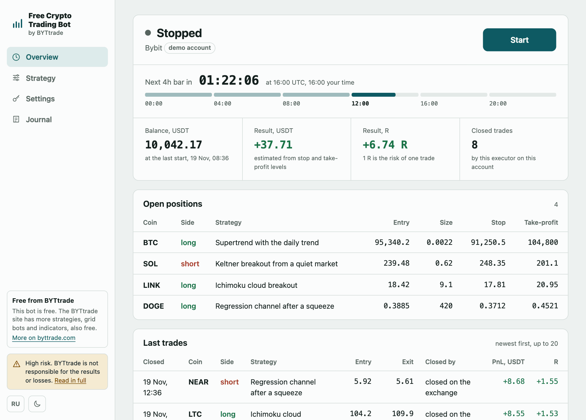
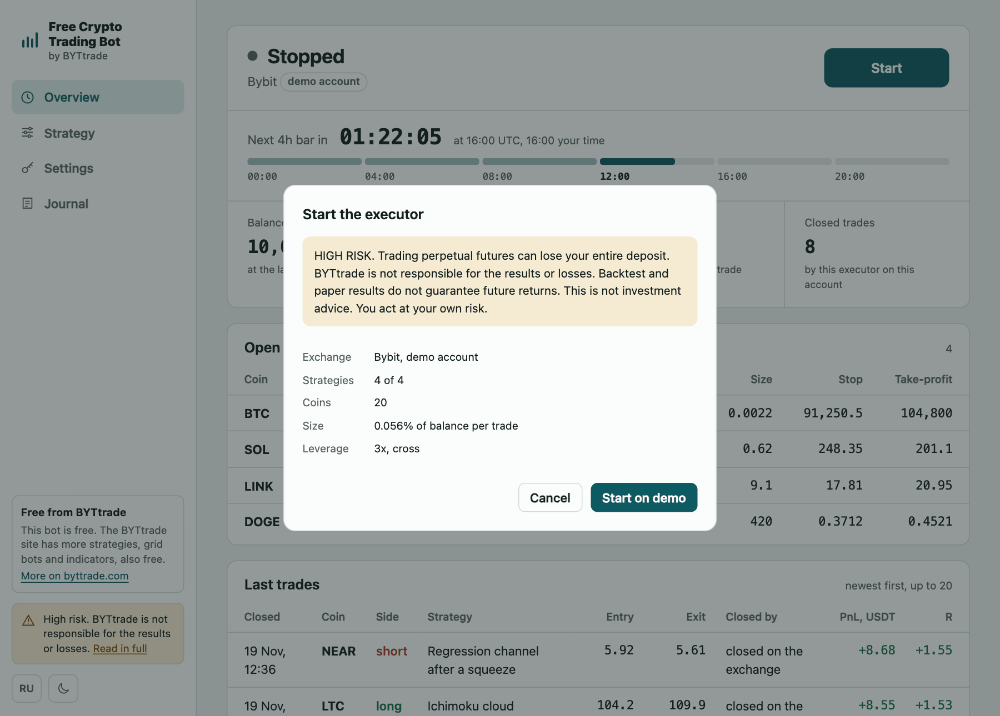
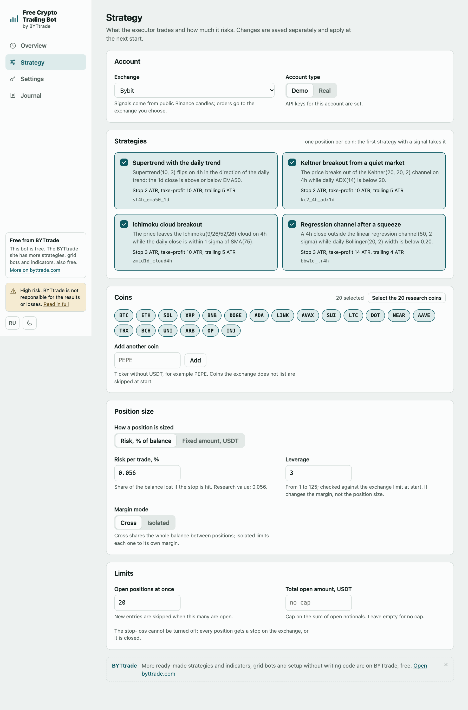
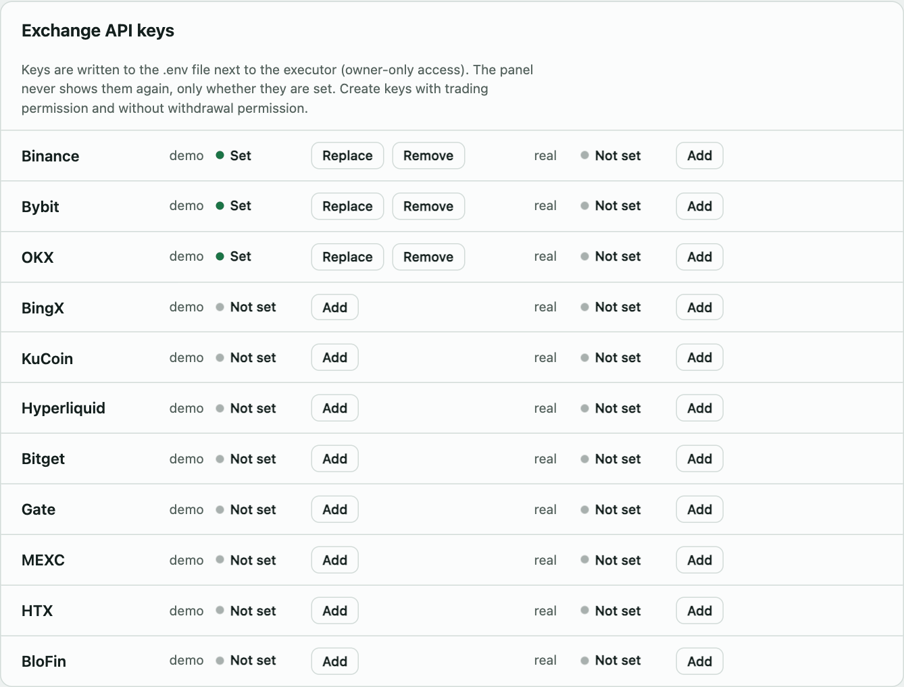
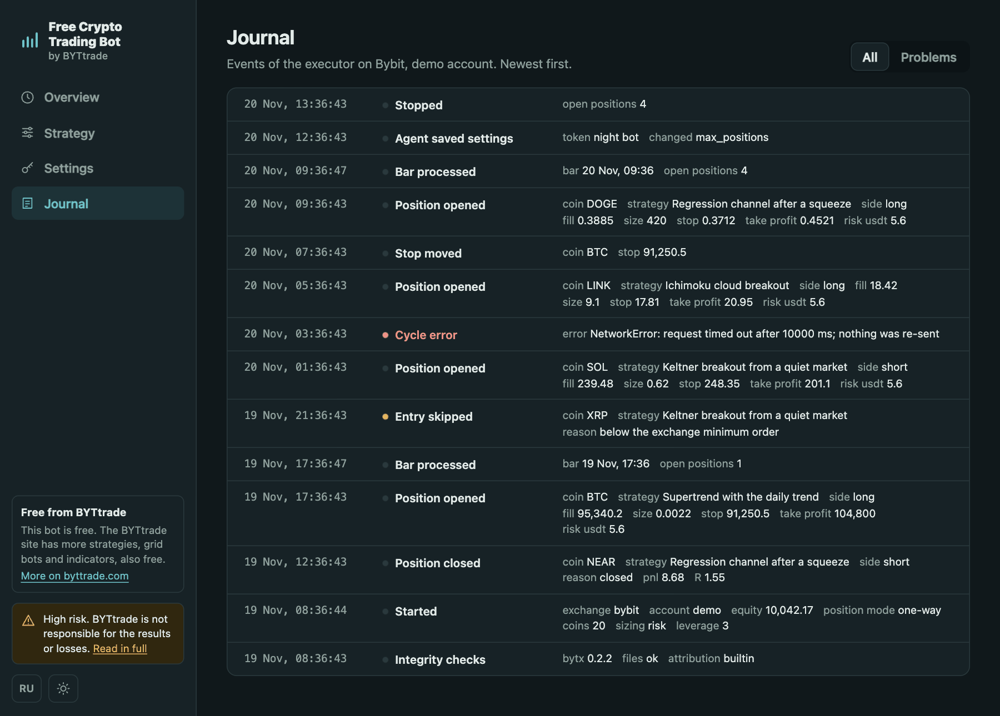
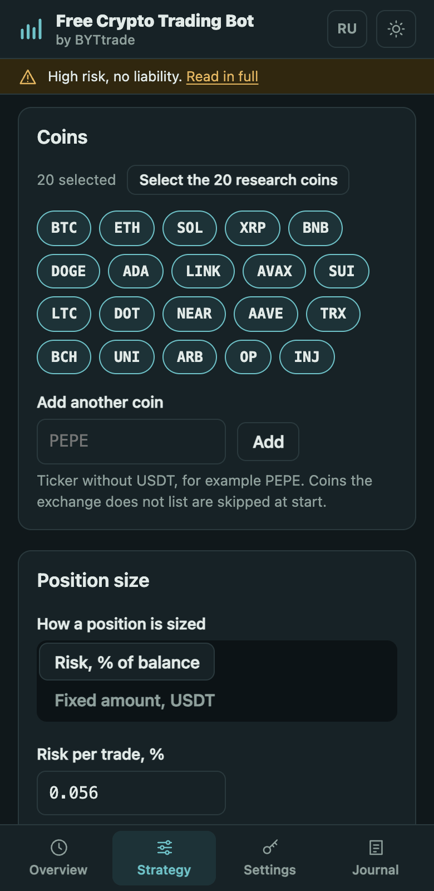
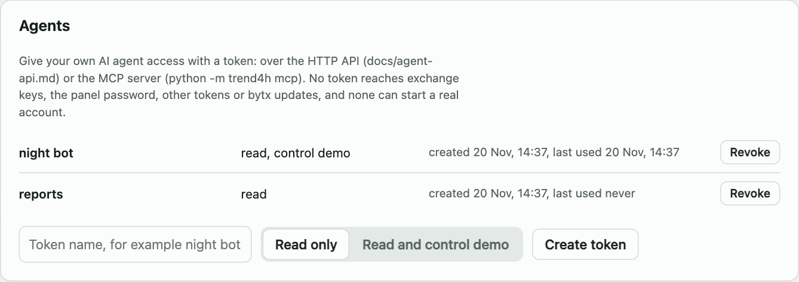

# Guide

[Русская версия](guide.ru.md) · [Back to the README](../README.md)

> **Risk warning.** Trading perpetual futures can lose your entire deposit. BYTtrade is not responsible for the
> results or losses. Backtest and paper results do not guarantee future returns. This is not investment advice.
> Start on a demo account.

The pictures show the panel with demo data: balances, positions and trades are invented.

## Contents

1. [Installation](#installation)
2. [Data and backtest](#data-and-backtest)
3. [The strategies in plain words](#the-strategies-in-plain-words)
4. [Settings](#settings)
5. [Exchange keys](#exchange-keys)
6. [Starting](#starting)
7. [The panel section by section](#the-panel-section-by-section)
8. [Running on a server](#running-on-a-server)
9. [Agents](#agents)
10. [What the executor does step by step](#what-the-executor-does-step-by-step)
11. [bytx auto-update](#bytx-auto-update)
12. [Integrity and broker attribution checks](#integrity-and-broker-attribution-checks)
13. [Journal and state files](#journal-and-state-files)
14. [Common errors](#common-errors)
15. [FAQ](#faq)

## Installation

You need Python 3.10 or newer and git.

```bash
git clone https://github.com/byttrade/free-crypto-trading-bot && cd free-crypto-trading-bot
python -m venv .venv && source .venv/bin/activate      # Windows: .venv\Scripts\activate
pip install -e '.[live]'
```

What the extras add:

| Install | What you get |
|---|---|
| `pip install -e .` | backtest only: numpy and pandas |
| `pip install -e '.[live]'` | the executor and the panel: adds the [bytx](https://github.com/byttrade/bytx) SDK |
| `pip install -e '.[live,agent]'` | also the MCP server for your own agent: adds the `mcp` package |
| `pip install -e '.[test]'` | pytest, to run the tests |

The project installs under the name `free-crypto-trading-bot`; the package you run is `trend4h`. Check it:

```bash
python -m trend4h --help
```

It lists the commands: `fetch`, `run`, `report`, `start`, `live`, `close`, `panel`, `panel-user`, `mcp`.

Every command works in the current folder: it reads `.env` from it and keeps its files in `state/` and `data/`
(change these with `--state-dir` and `--data-dir`). Run the commands from the project folder.

## Data and backtest

The backtest needs no keys and no account. It uses public Binance USDT-M candles.

```bash
python -m trend4h fetch          # 4h and 1d candles and funding for 20 coins since 2023-01-01, about 3 minutes, 11 MB in data/
python -m trend4h report         # all four strategies on both periods, rewrites results/*.csv
```

`fetch` prints a line per file, for example `BTC 4h: 180 bars`. `report` prints a table with trades, profit factor,
total R, drawdown and Sharpe for each strategy on the selection period (IS) and the verification year (OOS) and
writes `metrics_by_period.csv`, `by_half_year.csv` and `by_side.csv`.

`fetch` downloads up to 2026-06-30 by default (the end of the verification period), so `report` gives everyone the
same numbers. More commands:

```bash
python -m trend4h run specs/kc2_4h_adx1d.json --period oos --trades trades.csv    # one strategy, the trade list as CSV
python -m trend4h run specs/st4h_ema50_1d.json --from 2024-01-01 --to 2024-12-31  # any date range
python -m trend4h run specs/bbw1d_lr4h.json --config config.example.json          # your coins, costs and sizing
python -m trend4h fetch --coins BTC,ETH --end 2026-06-30                          # part of the data
pip install -e '.[test]' && pytest                                                # tests, no network needed
```

`run` prints the name of the strategy and one line per period with the same metrics, then the result by half-year
and by side. With `--config` it applies `coins`, `fee`, `slippage`, `risk_pct` and, for `sizing: notional`,
`notional_usdt` from your file, and warns when they differ from the research.

How the test was set up, what the costs are and what the numbers mean: [research.md](research.md).

## The strategies in plain words

All four share one idea: a filter on the daily chart decides whether to trade, a breakout or a flip on the 4h
chart gives the entry, and a wide trailing stop gives the exit. There is no exit by signal: a position ends at its
stop, its take-profit or its trailing stop. Distances are multiples of ATR(14) on 4h, fixed at the entry.

| Strategy | Trades when | Enters when | Stop / take-profit / trail |
|---|---|---|---|
| **Supertrend with the daily trend** `st4h_ema50_1d` | always, in the direction of the daily trend: long above the daily EMA(50), short below | Supertrend(10, 3) on 4h flips in that direction | 2 / 10 / 5 ATR |
| **Keltner breakout from a quiet market** `kc2_4h_adx1d` | the daily chart has no trend: ADX(14) below 20 | the 4h close crosses a Keltner(20, 20, 2) band: the upper one is a long, the lower one a short | 2 / 10 / 5 ATR |
| **Ichimoku cloud breakout** `zmid1d_cloud4h` | the daily close is near its average: within 1 sigma of SMA(75) | the 4h close leaves the Ichimoku(9/26/52/26) cloud by more than 0.2 %: up is a long, down a short | 3 / 10 / 5 ATR |
| **Regression channel after a squeeze** `bbw1d_lr4h` | the daily Bollinger(20, 2) bands are narrow: relative width below 0.20 | the 4h close is outside the linear regression channel(50, 2 sigma) | 3 / 14 / 4 ATR |

How to read the exits: with "2 / 10 / 5" the stop is 2 ATR from the entry, the take-profit 10 ATR, and the stop
follows the best price at a distance of 5 ATR. A trade that loses costs about 1 R (the risk you set); a trade that
reaches the take-profit earns several R. Most trades lose: the win rate in the backtest is 31–42 %.

The exact rules are the JSON files in [specs/](../specs/); the indicators are in `trend4h/indicators.py`.

## Settings

Settings live in a JSON file (see `config.example.json`) or are edited in the panel, section Strategy. Every
setting, its default and its limits:

| Setting | Default | Limits | What it does | What you risk by changing it |
|---|---|---|---|---|
| `exchange` | `bybit` | one of the 11 exchanges | where orders go | signals always come from Binance candles; prices on another exchange differ slightly |
| `account` | `demo` | `demo`, `real` | demo or real account | `real` puts real money at risk and needs a typed phrase |
| `strategies` | all four | a non-empty subset | which strategies are on | fewer strategies: fewer trades, a different result |
| `coins` | the 20 research coins | tickers such as `BTC` | which coins are traded | outside the 20 coins the strategies are not confirmed: on 639 other perpetuals the result was close to zero |
| `sizing` | `risk` | `risk`, `notional` | how a position is sized | see the two rows below |
| `risk_pct` | 0.056 | above 0, at most 5 | % of the balance lost if the stop is hit (with `sizing: risk`) | drawdown grows in proportion; 1 % with 20 correlated positions is far too much |
| `notional_usdt` | 100 | above 0 | fixed position amount in USDT (with `sizing: notional`) | the loss at the stop then depends on the stop distance and is different for every trade |
| `leverage` | 3 | 1 to 125, and the exchange limit | leverage set on the exchange | it changes the margin, not the position size; high leverage brings liquidation closer |
| `margin_mode` | `cross` | `cross`, `isolated` | margin mode | cross shares the whole balance; isolated limits a position to its own margin |
| `max_positions` | 20 | at least 1 | positions open at once | entries above the limit are skipped |
| `max_total_notional_usdt` | none | above 0 or `null` | cap on the sum of open position amounts | entries above the cap are skipped |
| `fee`, `slippage` | 0.0005, 0.0002 | 0 to 0.01 | costs per side, backtest only | the executor ignores them |
| `auto_update` | `on` | `on`, `notify`, `off` | what to do when a new bytx appears | see [bytx auto-update](#bytx-auto-update) |
| `update_margin_min` | 60 | at least 60 | no update closer than this many minutes to a 4h bar close | none |

The stop-loss cannot be turned off. The published results apply to the default settings only: the wizard, the
panel and the backtest say so when `strategies`, `coins`, `sizing`, `risk_pct`, `fee` or `slippage` differ.

An unknown setting or a value outside the limits is refused with a message that names it, for example
`leverage: from 1 to 125 (the exchange limit is checked at start)`.

## Exchange keys

The executor needs an API key of the account it trades. Create it on the exchange with these permissions:

- **on:** reading and derivatives (futures, contract, perpetual) trading;
- **off:** withdrawals and transfers. The executor never needs them;
- if your server has a fixed address, bind the key to it (IP whitelist).

For a **demo** account create the key inside the exchange's demo mode: it is a separate key.

| Exchange | Demo account | What to enter |
|---|---|---|
| Binance | yes (Demo Mode) | API key, secret |
| Bybit | yes (Demo Trading) | API key, secret |
| OKX | yes (demo trading) | API key, secret, passphrase |
| BingX | yes (virtual VST balance) | API key, secret |
| Hyperliquid | yes (testnet) | wallet address, private key of an API wallet |
| Bitget | yes | API key, secret, passphrase |
| Gate | yes (testnet) | API key, secret |
| BloFin | yes | API key, secret, passphrase |
| KuCoin | no | API key, secret, passphrase |
| MEXC | no | API key, secret |
| HTX | no | API key, secret |

On an exchange without a demo account you can still see what the executor would do: `live --dry-run` computes the
signals and prints the orders without sending anything.

**Through the panel.** Settings, Exchange API keys, Add. The panel writes the keys into `.env` in the folder it was
started from (file mode 600) and never shows them again, only "Set / Not set". Keys of the account the executor is
running on cannot be changed until you stop it.

The key form is available only when the connection is safe: the panel is opened on the same computer
(`127.0.0.1`, an SSH tunnel included) or over HTTPS. Over plain HTTP from another machine the form is replaced by
an explanation; use a tunnel, HTTPS, or the file.

**Through the file.** Copy `.env.example` to `.env` and fill it in. The names are
`<EXCHANGE>_<DEMO|REAL>_API_KEY`, `_SECRET`, `_PASSWORD` (the passphrase, where the exchange has one); for
Hyperliquid `_WALLET_ADDRESS` and `_PRIVATE_KEY`:

```bash
BYBIT_DEMO_API_KEY=...
BYBIT_DEMO_SECRET=...
OKX_DEMO_API_KEY=...
OKX_DEMO_SECRET=...
OKX_DEMO_PASSWORD=...
```

Never commit `.env`: it is in `.gitignore`.

## Starting

There are three ways. All of them run the same executor, one instance per account.

**The panel**, the easiest:

```bash
python -m trend4h panel          # http://127.0.0.1:8790
```

**The wizard**, in the terminal:

```bash
python -m trend4h start
```

It asks for the exchange, the account type, the strategies, the position size, the leverage and the margin mode,
reads the balance, shows a summary and waits for you to type `start`.

**Without questions**, for scripts and services:

```bash
python -m trend4h live --exchange bybit --account demo --strategies all --risk 0.056
python -m trend4h live --config config.example.json
python -m trend4h live --dry-run --coins BTC,ETH       # signals and orders are printed, nothing is sent; works without keys
python -m trend4h close --exchange bybit --account demo   # close the positions the executor opened
```

Flags of `live` and `close`: `--config`, `--exchange`, `--account`, `--strategies`, `--coins`, `--risk` (% of the
balance per trade), `--notional` (fixed USDT per trade), `--leverage`, `--margin-mode`, `--state-dir`. A flag
overrides the value from the config file.

`--dry-run` prints the risk notice, a `start` record and a `bar` record; when a strategy has a signal on the last
closed bar it also prints a `dry_run_order` record with the entry, stop and take-profit.

**A real account** always needs a confirmation. The wizard and the panel ask you to type `I ACCEPT THE RISK`;
`live` refuses to start without `--confirm-real "I ACCEPT THE RISK"`:

```
real account: start refused without the confirmation phrase. Add --confirm-real "I ACCEPT THE RISK" ...
```

Stopping (Ctrl+C, the Stop button) does not close positions: they stay on the exchange with their stops. To close
them use `close`.

## The panel section by section

```bash
python -m trend4h panel                    # http://127.0.0.1:8790
python -m trend4h panel --port 8791        # another port
python -m trend4h panel-user               # set a login and password
```

English and Russian, light and dark theme; the choice is remembered in the browser.

### Overview



The state (running, stopped, new orders blocked and why), the exchange and the account, the time to the next 4h
bar, the balance, the result in USDT and in R, the number of closed trades, open positions and the last trades.
One button: Start or Stop.

The result is estimated from stop and take-profit levels; your exchange statement is the source of truth. The
balance is read from the exchange while the executor runs; when it is stopped the panel shows the balance at the
last start.

Start opens a dialog with the risk notice and a summary of what will start. A real account has its own dialog
where you type the phrase.



### Strategy



The exchange and the account, the four strategies, the coins (the 20 research coins as chips, plus your own with
a warning), the position size (risk or fixed amount), leverage, margin mode and limits. When the settings differ
from the research the page says so and offers to return to the defaults.

Settings are saved with their own button and apply at the next start. A running executor keeps the settings it
was started with.

### Settings



- **Exchange API keys:** see [Exchange keys](#exchange-keys).
- **bytx SDK updates:** the installed and the available version, what to do with a new version, the time of the
  last check, and "Update now" (works while the executor runs).
- **Agents:** access tokens for your own agents, see [Agents](#agents).
- **Access to the panel:** the login and password, sign out.
- **Language and theme.**

### Journal



The last events of the executor on the chosen account, newest first, with a filter that leaves only problems.
See [Journal and state files](#journal-and-state-files).

### On a phone



The same sections with the navigation at the bottom.

## Running on a server

By default the panel listens on `127.0.0.1` and needs no password: only this computer can open it.

**The simplest safe way** is to leave it like that and use an SSH tunnel from your own computer:

```bash
ssh -L 8790:127.0.0.1:8790 user@server      # then open http://127.0.0.1:8790 at home
```

**Listening on a public address** needs a login and password first, otherwise the panel refuses to start:

```bash
python -m trend4h panel-user                 # asks for a login and a password of 8+ characters
python -m trend4h panel --host 0.0.0.0
```

Only a salted scrypt hash of the password is stored (`state/panel-user.json`, mode 600). Failed logins are delayed
and the address is locked out for five minutes after five of them.

The panel has no TLS by default, and over plain HTTP the password travels in clear text. Use one of these:

- TLS in the panel itself: `python -m trend4h panel --host 0.0.0.0 --certfile cert.pem --keyfile key.pem`;
- an HTTPS reverse proxy on the same server in front of `127.0.0.1:8790`. Start the panel with
  `--behind-https-proxy` so that it trusts the proxy's `X-Forwarded-Proto` header; without the flag the forms for
  keys, tokens and the password stay closed behind a proxy.

**As a service.** An example of a systemd unit (adjust the user and the paths; this example was not run as part of
the project's checks):

```ini
[Unit]
Description=Free Crypto Trading Bot panel
After=network-online.target
Wants=network-online.target

[Service]
User=bot
WorkingDirectory=/home/bot/free-crypto-trading-bot
ExecStart=/home/bot/free-crypto-trading-bot/.venv/bin/python -m trend4h panel
Restart=on-failure
RestartSec=10

[Install]
WantedBy=multi-user.target
```

After a restart of the service the panel does not start the executor by itself: open it and press Start. Open
positions keep their stops on the exchange meanwhile. If you want the executor to come back on its own after a
reboot, run `python -m trend4h live --config state/config.json` as the service instead of the panel (the wizard
saves that file; for a real account add `--confirm-real`). Use one of the two for an account, not both: a panel
next to a `live` service does not see that the executor is running, and a second executor on the same account
refuses to start.

## Agents

Your own AI agent or script can work with the executor through an access token.

1. In the panel open Settings, Agents and create a token. Rights: `read` (status, positions, trades, journal,
   settings) or `control` (also: save strategy settings, start and stop on demo, close the executor's demo
   positions). The value is shown once.

   

2. Give it to the agent, either as an HTTP API:

   ```bash
   export TREND4H_TOKEN=...          # the value from the panel
   curl -s -H "Authorization: Bearer $TREND4H_TOKEN" http://127.0.0.1:8790/api/v1/status
   ```

   or as an MCP server:

   ```bash
   pip install -e '.[agent]'
   ```

   ```json
   {
     "mcpServers": {
       "free-crypto-trading-bot": {
         "command": "python",
         "args": ["-m", "trend4h", "mcp", "--url", "http://127.0.0.1:8790"],
         "env": {"TREND4H_TOKEN": "<token from the panel>"}
       }
     }
   }
   ```

What no token can do: read, write or delete exchange keys; touch the panel password, tokens or bytx updates; start,
stop or close anything on a real account. Settings from an agent pass the same checks as settings from the page.
Every action is written to the journal with the name of the token.

Tokens also work on a non-local address, but over plain HTTP a token travels in clear text: use HTTPS or a tunnel.

All endpoints, examples and error codes: [agent-api.md](agent-api.md).

## What the executor does step by step

**At start** it checks the bytx files and the broker attribution, reads the balance (it must be above zero), the
position mode and the markets of your coins. A coin the exchange does not list is skipped with a journal record.
Leverage above the exchange limit stops the start with a message. Then it reconciles its saved positions with the
exchange.

**Once per closed 4h bar** (bars close at 00:00, 04:00, 08:00, 12:00, 16:00 and 20:00 UTC), 20 seconds after the
close:

1. It reconciles with the exchange: a position that is gone was closed by its stop or take-profit and becomes a
   trade; a position without a stop gets one or is closed.
2. It moves trailing stops: a stop only moves in the direction of profit.
3. For every coin without a position it computes the signals on public Binance candles. The first strategy with a
   signal takes the coin; a long wins over a short on the same bar.
4. It enters with a market order sized by your risk setting. The stop-loss goes to the exchange with the entry; the
   take-profit is a second exchange order. If the stop cannot be placed, the position is closed at once.

Between bars it reconciles with the exchange every five minutes.

**Rules it keeps:**

- one position per coin. If two strategies want the same coin, the first one takes it, so live results differ
  from the sum of four backtests;
- a coin where the account already has a position the executor did not open is left alone, and so are orders it
  did not place;
- an entry later than 20 minutes after the bar opened is skipped: the price has moved on;
- an order below the exchange minimum is skipped with a journal record;
- limits `max_positions` and `max_total_notional_usdt` are checked before every entry.

**When the network drops.** An order is never sent a second time. If the answer to an entry did not arrive, the
position is marked as unknown and the executor looks the order up on the exchange by its client id: found and
filled, it becomes a normal position with a stop; not found within 20 minutes, the record is dropped. Other
network errors are written to the journal (`cycle_error`) and the next pass reconciles.

**When it is stopped or the computer is off**, positions stay on the exchange with their stops and take-profits.
After a restart the executor reads its state file and reconciles. What it cannot do while it is off is move
trailing stops and open new positions.

**What it does not do:** it does not model funding, liquidation or exchange outages, and it estimates the result
from stop and take-profit levels instead of reading exit prices from the exchange.

## bytx auto-update

Orders go through the bytx SDK. Once a day the executor asks PyPI whether a newer bytx exists inside the allowed
range (`>=0.2.2,<0.3`).

| `auto_update` | What happens |
|---|---|
| `on` (default) | the new version is installed in a safe window, verified, and the executor restarts |
| `notify` | the journal reports the new version; you install it yourself |
| `off` | PyPI is not asked |

A safe window means: no exchange request is in flight, more than `update_margin_min` minutes (60 by default) are
left to the next 4h bar close, and the last bar was processed at least five minutes ago. The new version is
verified in a separate process. On any failure the previous version is put back, the reason is written to the
journal, and that version is not tried again for a day. Exchange stops are never touched. This project itself is
not auto-updated: use `git pull`.

Be aware that an auto-update installs code from PyPI into a process that holds your exchange keys. If you prefer
to update by hand, choose `notify` or `off` and run `pip install -U 'bytx>=0.2.2,<0.3'`.

## Integrity and broker attribution checks

Orders go out only through bytx as it was released and with its broker attribution intact. Broker attribution is
the BYTtrade broker identifier that bytx adds to orders; it is how the project is paid for (see [FAQ](#faq)).

Before the start, before every batch of orders and every ten minutes the executor checks that:

- the installed bytx files match the checksums of the released package;
- the broker identifier of your exchange comes from bytx itself, not from an environment variable or a setting;
- where the exchange returns the tag on an order, the tag of a placed order is the built-in one.

| Exchange | bytx files (checksums, import path) | Attribution source | Tag read back from the order |
|---|---|---|---|
| Bybit | yes | must be `builtin` | no (configuration check only) |
| OKX | yes | must be `builtin` | yes, field `tag` |
| KuCoin | yes | must be `builtin` | no |
| BloFin | yes | must be `builtin` | yes, field `brokerId` |
| Binance, BingX, Bitget, Gate, MEXC, Hyperliquid, HTX | yes | bytx 0.2.2 has no built-in code: the source must be `none` | no |

The list of exchanges with a built-in code is read from the installed bytx at start, so a newer bytx that adds a
code is enforced without changes here.

If a check fails, no new orders are sent and the reason is shown in the panel and the journal
(`orders_blocked`). Protective stops that are already on the exchange stay there. To fix it:

```bash
pip install --force-reinstall 'bytx>=0.2.2,<0.3'
```

and remove broker settings from the environment. Changing bytx or its attribution is not permitted by the license
(sections 2(e), 3(a), 3(g)).

## Journal and state files

Everything is kept in `state/` (or the folder given by `--state-dir`):

| File | What it is |
|---|---|
| `<exchange>-<account>/state.json` | open positions, closed trades and the last processed bar |
| `<exchange>-<account>/journal.jsonl` | the journal: one JSON record per line |
| `<exchange>-<account>.lock` | the lock: one executor per account |
| `config.json` | settings saved by the wizard |
| `panel-config.json` | settings saved in the panel |
| `panel-user.json` | the login and the password hash of the panel |
| `panel-tokens.json` | agent tokens: names, rights and hashes |
| `update.json` | the state of the bytx update check |

Keys are not stored here: they are in `.env`.

The main journal events:

| Event | Meaning |
|---|---|
| `start`, `stopped` | the executor started or stopped |
| `bar` | a 4h bar was processed |
| `entry`, `exit` | a position was opened or closed |
| `entry_skipped` | a signal was not traded; the record gives the reason |
| `entry_unknown`, `entry_found`, `entry_lost` | the answer to an entry was lost; the order was then found or not |
| `trail`, `stop_placed` | a stop was moved or placed |
| `stop_not_placed`, `close_failed`, `cycle_error` | a problem; the record carries the exchange's error text |
| `orders_blocked`, `orders_unblocked` | the integrity checks stopped or allowed new orders |
| `update_*` | bytx update: available, started, done, failed, rolled back |
| `agent_*` | an action of an agent, with the token name |

## Common errors

| What you see | Why | What to do |
|---|---|---|
| `no API keys for bybit demo ...` | there are no keys for this exchange and account | add them in Settings or in `.env`; check that you run from the folder with `.env` |
| `cannot read the account balance (check the API keys and their permissions)` | wrong key, a demo key on a real account or the other way round, no trading permission, or the key is bound to another IP | recreate the key for the right account type with derivatives trading |
| `the account has no USDT balance` | the futures wallet is empty | top up the demo balance or transfer USDT to the futures account |
| "New orders blocked" in the panel, `orders_blocked` in the journal | an integrity or broker attribution check failed | `pip install --force-reinstall 'bytx>=0.2.2,<0.3'`, remove broker settings from the environment, restart |
| `entry_skipped ... below the exchange minimum order` | the position size from your risk setting is smaller than the exchange allows | raise `risk_pct` or use `sizing: notional`; on a small balance cheap coins pass more often than BTC |
| `position mode is not usable ... Switch the account to one-way mode` | the exchange did not report the position mode | set one-way mode for USDT perpetuals on the exchange and start again |
| `leverage 20 is above the exchange limit 10 for XRP: lower it` | the exchange does not allow this leverage for a coin | lower `leverage` |
| `CERTIFICATE_VERIFY_FAILED` during `fetch` | this Python has no root certificates | `pip install certifi` and run again |
| `Address already in use` when the panel starts | the port is taken | `python -m trend4h panel --port 8791` |
| `refusing to listen on 0.0.0.0 without a login and password` | a public address needs a password | `python -m trend4h panel-user` |
| `another executor already runs on ...lock` | this account is already traded by another process | stop the other one; one executor per account |
| `data/BTC_4h.csv not found` | the backtest has no data yet | `python -m trend4h fetch` |
| the key form says keys cannot be entered over this connection | plain HTTP from another machine | SSH tunnel, HTTPS, or `.env` on the server |
| the panel shows the sign-in form after a restart | the session ended with the restart | sign in again, or reload the page if no password is set |

## FAQ

**Is it really free?** Yes. There is no subscription, no paid tier and no fee to BYTtrade.

**Then how does BYTtrade earn?** Through the broker programmes of the exchanges. On the exchanges where bytx has
a broker code (in bytx 0.2.2: Bybit, OKX, KuCoin and BloFin) orders carry BYTtrade's broker identifier, and the
exchange shares a part of its own fee with BYTtrade. You pay the exchange its usual fees, nothing on top. This is
why the broker attribution cannot be switched off and why the integrity checks exist.

**Can I change the code?** No: the license lets you run the software, trade with it and add your own strategy
specs, configs and your own code next to it, but not modify the project or bytx, and not distribute modified
versions. The text of the [LICENSE](../LICENSE) is what counts.

**Can I add my own strategy?** A new JSON file next to the four in `specs/` can be backtested with
`python -m trend4h run your.json`, using the indicators that already exist. The executor trades the four
strategies of the project.

**What are the risks?** You can lose the whole deposit. The backtest is not a track record; outside the 20 coins
the strategies are not confirmed; the four strategies fall together; leverage brings liquidation closer; the
exchange can be unavailable exactly when the market moves. Read [the limitations](research.md#honest-limitations).

**Why does a demo result differ from the backtest?** The executor holds one position per coin while the backtest
counts each strategy separately; demo prices and fills are not the real market; and the result in the panel is an
estimate from stop and take-profit levels.

**Which exchange should I choose?** The signals are computed on Binance candles for every exchange. Choose the one
where you have an account; start with a demo account where the exchange has one.

**Does it need to run all the time?** New positions are opened and trailing stops are moved only while it runs.
Positions that are already open keep their exchange stops when it is off.

**Where are my keys stored?** In the `.env` file on your own machine, readable by your user only. The panel never
sends them back to the browser and the project has no server of its own.
