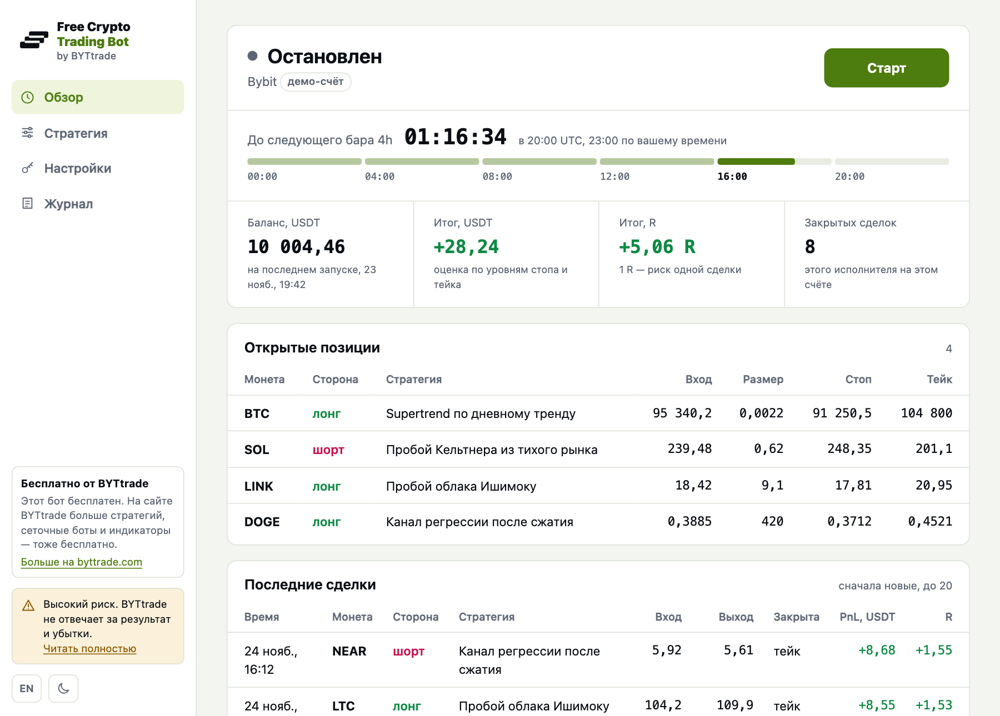
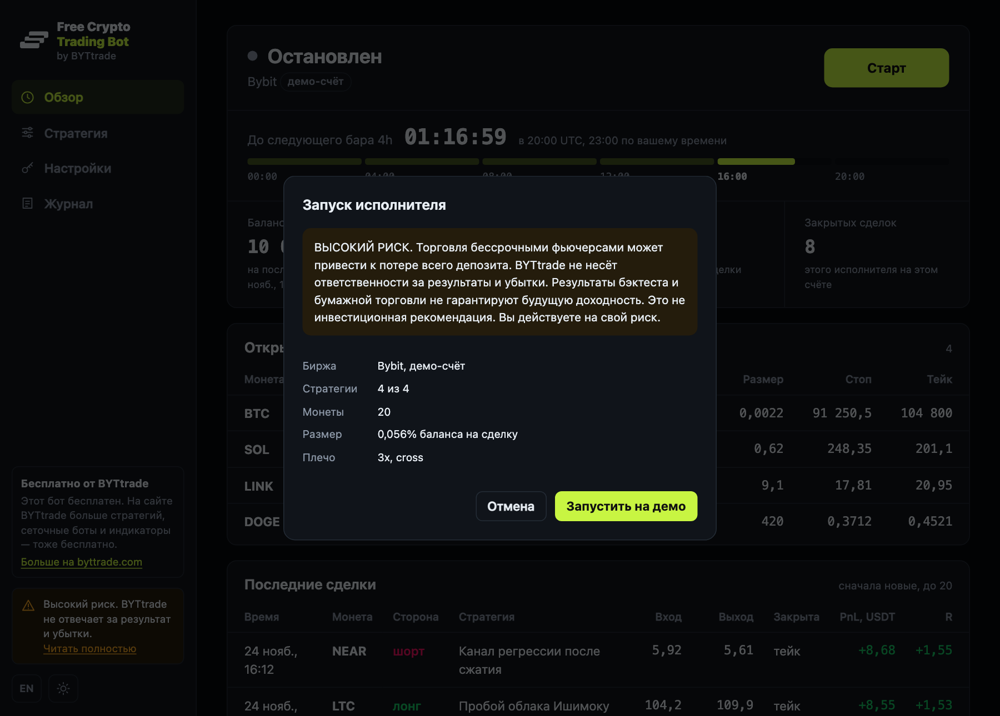
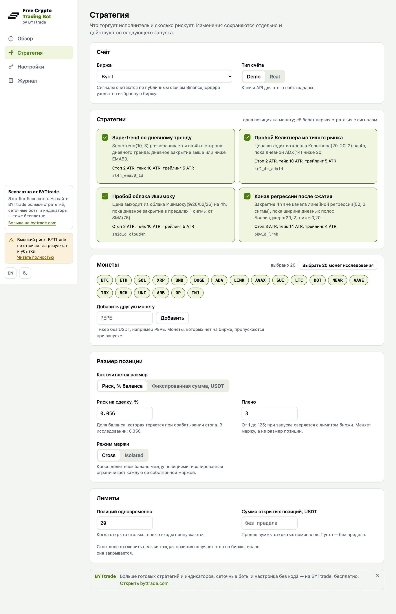
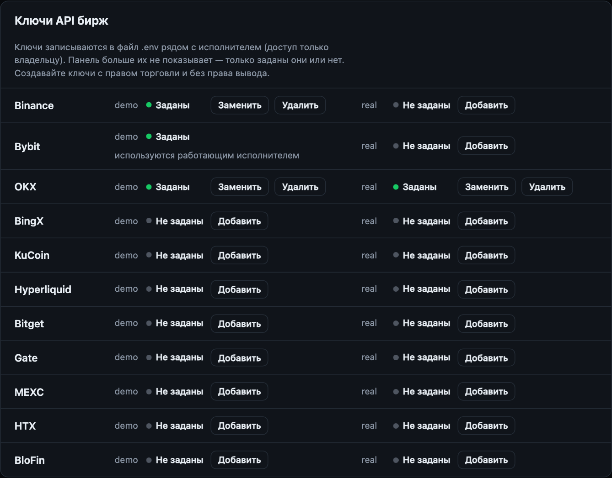
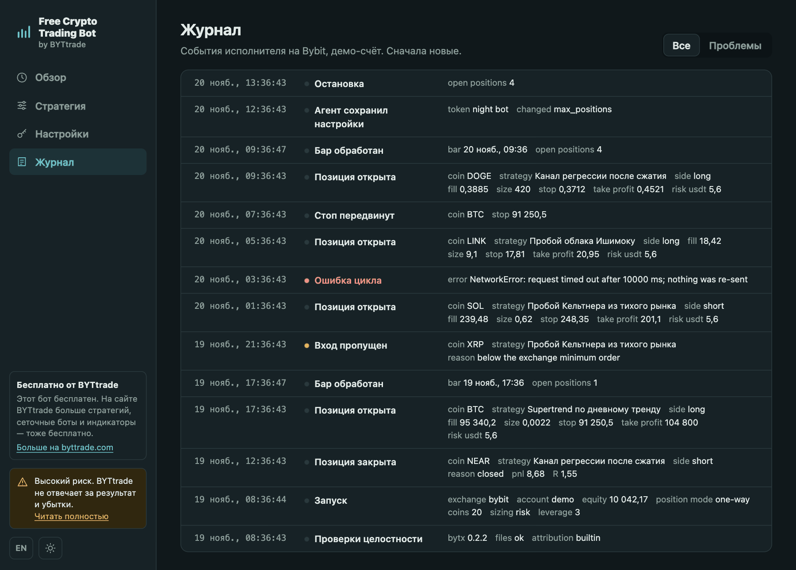
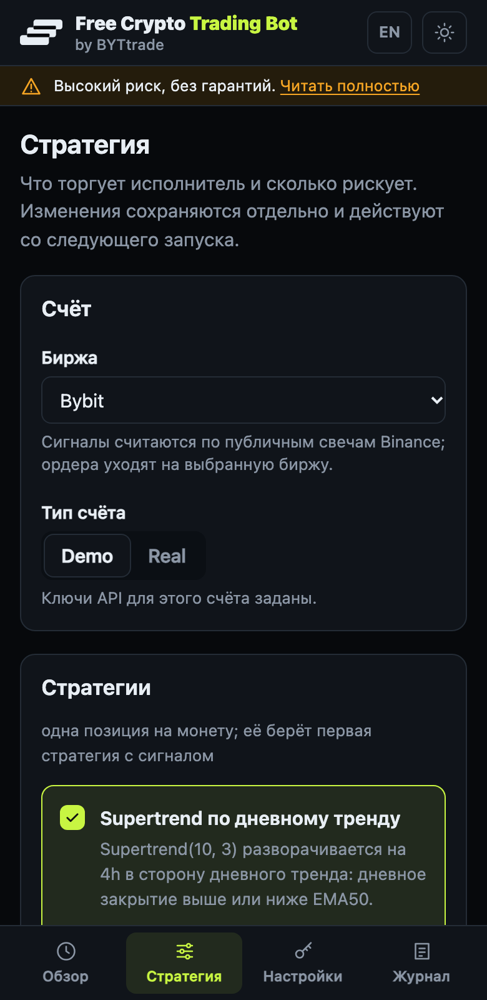
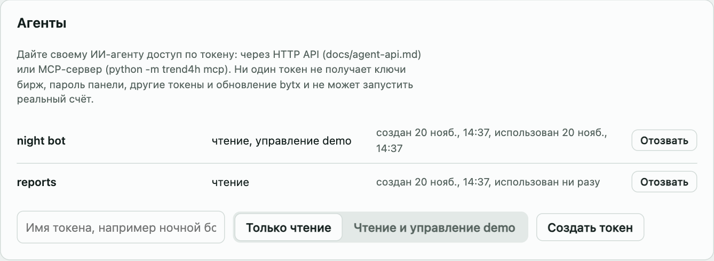

# Руководство

[English version](guide.md) · [Назад к README](../README.ru.md)

> **Предупреждение о риске.** На бессрочных фьючерсах можно потерять весь депозит. BYTtrade не несёт
> ответственности за результаты и убытки. Результаты бэктеста и бумажной торговли не гарантируют будущую
> доходность. Это не инвестиционная рекомендация. Начинайте с демо-счёта.

На картинках панель с данными для примера: балансы, позиции и сделки вымышлены.

## Содержание

1. [Установка](#установка)
2. [Данные и бэктест](#данные-и-бэктест)
3. [Стратегии по-человечески](#стратегии-по-человечески)
4. [Настройки](#настройки)
5. [Ключи бирж](#ключи-бирж)
6. [Запуск](#запуск)
7. [Панель по разделам](#панель-по-разделам)
8. [Работа на сервере](#работа-на-сервере), [Docker](#docker)
9. [Агенты](#агенты)
10. [Что делает исполнитель шаг за шагом](#что-делает-исполнитель-шаг-за-шагом)
11. [Автообновление bytx](#автообновление-bytx)
12. [Проверки целостности и брокерской метки](#проверки-целостности-и-брокерской-метки)
13. [Журнал и файлы состояния](#журнал-и-файлы-состояния)
14. [Частые ошибки](#частые-ошибки)
15. [Вопросы и ответы](#вопросы-и-ответы)

## Установка

Способов три. Все дают одну и ту же программу.

**1. Из PyPI** (Python 3.10 или новее):

```bash
python -m venv .venv && source .venv/bin/activate      # Windows: .venv\Scripts\activate
pip install 'free-crypto-trading-bot[live]'
free-crypto-trading-bot --help
```

Или через [uv](https://docs.astral.sh/uv/), ничего не устанавливая насовсем:

```bash
uvx --from 'free-crypto-trading-bot[live]' free-crypto-trading-bot panel
```

**2. Docker:** см. [Docker](#docker).

**3. Из исходников:**

```bash
git clone https://github.com/byttrade/free-crypto-trading-bot && cd free-crypto-trading-bot
python -m venv .venv && source .venv/bin/activate
pip install -e '.[live]'
```

Что добавляют варианты установки:

| Установка | Что получаете |
|---|---|
| `free-crypto-trading-bot` | только бэктест: numpy и pandas |
| `free-crypto-trading-bot[live]` | исполнитель и панель: добавляет SDK [bytx](https://github.com/byttrade/bytx) |
| `free-crypto-trading-bot[agent]` | MCP-сервер для своего агента: добавляет пакет `mcp` |
| `free-crypto-trading-bot[all]` | `live` и `agent` вместе |
| `free-crypto-trading-bot[test]` | pytest, чтобы запускать тесты из исходников |

У команды три имени, они делают одно и то же: `free-crypto-trading-bot`, `trend4h` и `python -m trend4h`. В этом
руководстве пишется `python -m trend4h`; используйте любое. Команды: `fetch`, `run`, `report`, `start`, `live`,
`close`, `panel`, `panel-user` и `mcp`; `--version` печатает версию.

**Где лежат ваши файлы.** Каждая команда работает в текущей папке: читает из неё `.env` и хранит файлы в `state/` и
`data/` (меняется флагами `--state-dir` и `--data-dir`). Внутри установленного пакета ничего вашего не хранится,
поэтому переустановка и обновление ничего не теряют. Заведите для бота папку и всегда запускайте команды из неё:

```bash
mkdir ~/trading-bot && cd ~/trading-bot
free-crypto-trading-bot panel
```

Четыре спецификации стратегий поставляются внутри пакета. `config.example.json` и `.env.example` лежат в
[репозитории](https://github.com/byttrade/free-crypto-trading-bot); что в них писать, показано ниже.

### Обновление

| Чем установлено | Чем обновлять |
|---|---|
| pip | `pip install -U free-crypto-trading-bot` |
| uvx | `uvx --from 'free-crypto-trading-bot[live]@latest' free-crypto-trading-bot panel` |
| Docker | `docker compose pull && docker compose up -d` |
| исходники | `git pull` |

Сначала остановите исполнитель; открытые позиции защищены стопами на бирже. Программа сама себя не обновляет: когда
выходит новый выпуск, об этом сообщают журнал и панель («Настройки» → «Обновления»). Сам обновляться может только
SDK bytx, см. [Автообновление bytx](#автообновление-bytx). Что менялось в выпусках — в
[списке изменений](https://github.com/byttrade/free-crypto-trading-bot/blob/main/CHANGELOG.md) (на английском).

## Данные и бэктест

Для бэктеста не нужны ни ключи, ни счёт. Он использует публичные свечи Binance USDT-M.

```bash
python -m trend4h fetch          # свечи 4h и 1d и фандинг по 20 монетам с 2023-01-01, около 3 минут, 11 МБ в data/
python -m trend4h report         # все четыре стратегии на обоих периодах, перезаписывает results/*.csv
```

`fetch` печатает строку на файл, например `BTC 4h: 180 bars`. `report` печатает таблицу: сделки, профит-фактор,
итог в R, просадка и Шарп по каждой стратегии на периоде отбора (IS) и в проверочном году (OOS) — и записывает
`metrics_by_period.csv`, `by_half_year.csv` и `by_side.csv`.

По умолчанию `fetch` качает данные до 2026-06-30 (конец проверочного периода), чтобы `report` давал всем одинаковые
числа. Ещё команды:

```bash
python -m trend4h run kc2_4h_adx1d --period oos --trades trades.csv    # одна стратегия, список сделок в CSV
python -m trend4h run st4h_ema50_1d --from 2024-01-01 --to 2024-12-31  # произвольный диапазон дат
python -m trend4h run bbw1d_lr4h --config my.json                      # свои монеты, издержки и размер
python -m trend4h fetch --coins BTC,ETH --end 2026-06-30                          # часть данных
python -m trend4h run ./my_strategy.json                               # своя спецификация
```

`run` принимает встроенную стратегию по имени (`st4h_ema50_1d`, `kc2_4h_adx1d`, `zmid1d_cloud4h`, `bbw1d_lr4h`) или
путь к своему файлу спецификации. Он печатает название стратегии и по строке на период с теми же метриками, затем результат по полугодиям и по
сторонам. С `--config` он берёт из вашего файла `coins`, `fee`, `slippage`, `risk_pct` и, при `sizing: notional`,
`notional_usdt` и предупреждает, если они отличаются от исследовательских.

Как устроена проверка, какие заложены издержки и что означают числа — в [research.ru.md](research.ru.md).

## Стратегии по-человечески

У всех четырёх одна идея: фильтр на дневном графике решает, торговать ли; пробой или разворот на графике 4h даёт
вход; широкий трейлинг-стоп даёт выход. Выхода по сигналу нет: позиция заканчивается стопом, тейком или
трейлинг-стопом. Расстояния заданы в ATR(14) на 4h и фиксируются на входе.

| Стратегия | Когда торгует | Когда входит | Стоп / тейк / трейл |
|---|---|---|---|
| **Supertrend по дневному тренду** `st4h_ema50_1d` | всегда, в сторону дневного тренда: лонг выше дневной EMA(50), шорт ниже | Supertrend(10, 3) на 4h разворачивается в эту сторону | 2 / 10 / 5 ATR |
| **Пробой Кельтнера из тихого рынка** `kc2_4h_adx1d` | на дневном графике нет тренда: ADX(14) ниже 20 | закрытие 4h пересекает границу канала Кельтнера(20, 20, 2): верхнюю — лонг, нижнюю — шорт | 2 / 10 / 5 ATR |
| **Пробой облака Ишимоку** `zmid1d_cloud4h` | дневное закрытие около своего среднего: в пределах 1 сигмы от SMA(75) | закрытие 4h выходит из облака Ишимоку(9/26/52/26) больше чем на 0,2 %: вверх — лонг, вниз — шорт | 3 / 10 / 5 ATR |
| **Канал регрессии после сжатия** `bbw1d_lr4h` | дневные полосы Боллинджера(20, 2) узкие: относительная ширина ниже 0,20 | закрытие 4h вне канала линейной регрессии(50, 2 сигмы) | 3 / 14 / 4 ATR |

Как читать выходы: при «2 / 10 / 5» стоп стоит в 2 ATR от входа, тейк — в 10 ATR, а стоп идёт за лучшей ценой на
расстоянии 5 ATR. Убыточная сделка стоит около 1 R (риск, который вы задали); сделка, дошедшая до тейка, приносит
несколько R. Большинство сделок убыточны: доля прибыльных в бэктесте — 31–42 %.

Точные правила — JSON-файлы в [trend4h/specs/](../trend4h/specs/); индикаторы — в `trend4h/indicators.py`.

## Настройки

Настройки хранятся в JSON-файле (пример — [config.example.json](../config.example.json)) или редактируются в панели, раздел «Стратегия».
Каждый параметр, его значение по умолчанию и пределы:

| Параметр | По умолчанию | Пределы | Что делает | Чем рискуете при изменении |
|---|---|---|---|---|
| `exchange` | `bybit` | одна из 11 бирж | куда уходят ордера | сигналы всегда считаются по свечам Binance; цены на другой бирже немного отличаются |
| `account` | `demo` | `demo`, `real` | демо или реальный счёт | `real` — под риском настоящие деньги, нужна фраза подтверждения |
| `strategies` | все четыре | непустое подмножество | какие стратегии включены | меньше стратегий — меньше сделок и другой результат |
| `coins` | 20 монет исследования | тикеры вида `BTC` | какие монеты торгуются | вне 20 монет стратегии не подтверждены: на 639 других контрактах результат был около нуля |
| `sizing` | `risk` | `risk`, `notional` | как считается размер позиции | см. две строки ниже |
| `risk_pct` | 0,056 | больше 0, не больше 5 | % баланса, теряемый при срабатывании стопа (при `sizing: risk`) | просадка растёт пропорционально; 1 % при 20 коррелированных позициях — слишком много |
| `notional_usdt` | 100 | больше 0 | фиксированная сумма позиции в USDT (при `sizing: notional`) | убыток на стопе зависит от расстояния до стопа и у каждой сделки свой |
| `leverage` | 3 | от 1 до 125 и лимит биржи | плечо, которое ставится на бирже | меняет маржу, а не размер позиции; большое плечо приближает ликвидацию |
| `margin_mode` | `cross` | `cross`, `isolated` | режим маржи | кросс делит весь баланс; изолированная ограничивает позицию её собственной маржой |
| `max_positions` | 20 | не меньше 1 | позиций одновременно | входы сверх лимита пропускаются |
| `max_total_notional_usdt` | нет | больше 0 или `null` | предел суммы открытых позиций | входы сверх предела пропускаются |
| `fee`, `slippage` | 0,0005 и 0,0002 | от 0 до 0,01 | издержки на сторону, только для бэктеста | исполнитель их не использует |
| `auto_update` | `on` | `on`, `notify`, `off` | что делать при выходе нового bytx | см. [Автообновление bytx](#автообновление-bytx) |
| `update_margin_min` | 60 | не меньше 60 | не обновляться ближе стольких минут к закрытию бара 4h | ничем |

В JSON-файле дробные числа пишутся через точку: `0.056`.

Стоп-лосс отключить нельзя. Опубликованные результаты относятся только к настройкам по умолчанию: мастер, панель и
бэктест сообщают об этом, когда отличаются `strategies`, `coins`, `sizing`, `risk_pct`, `fee` или `slippage`.

Неизвестный параметр или значение вне пределов отклоняется с сообщением, которое его называет, например
`leverage: from 1 to 125 (the exchange limit is checked at start)`.

## Ключи бирж

Исполнителю нужен ключ API того счёта, на котором он торгует. Создайте его на бирже с такими правами:

- **включить:** чтение и торговлю деривативами (фьючерсы, контракты, бессрочные);
- **выключить:** вывод средств и переводы. Исполнителю они не нужны никогда;
- если у сервера постоянный адрес, привяжите ключ к нему (белый список IP).

Для **демо**-счёта ключ создаётся внутри демо-режима биржи: это отдельный ключ.

| Биржа | Демо-счёт | Что вводить |
|---|---|---|
| Binance | есть (Demo Mode) | API key, secret |
| Bybit | есть (Demo Trading) | API key, secret |
| OKX | есть (demo trading) | API key, secret, passphrase |
| BingX | есть (виртуальный баланс VST) | API key, secret |
| Hyperliquid | есть (testnet) | адрес кошелька, приватный ключ API-кошелька |
| Bitget | есть | API key, secret, passphrase |
| Gate | есть (testnet) | API key, secret |
| BloFin | есть | API key, secret, passphrase |
| KuCoin | нет | API key, secret, passphrase |
| MEXC | нет | API key, secret |
| HTX | нет | API key, secret |

На бирже без демо-счёта всё равно можно посмотреть, что сделал бы исполнитель: `live --dry-run` считает сигналы и
печатает ордера, ничего не отправляя.

**Через панель.** «Настройки» → «Ключи API бирж» → «Добавить». Панель записывает ключи в `.env` в папке, из которой
её запустили (права 600), и больше их не показывает — только «Заданы / Не заданы». Ключи счёта, на котором работает
исполнитель, нельзя менять, пока вы его не остановите.

Форма ключей доступна только при безопасном соединении: панель открыта на том же компьютере (`127.0.0.1`, в том
числе через SSH-туннель) или по HTTPS. По обычному HTTP с другой машины вместо формы показывается объяснение;
используйте туннель, HTTPS или файл.

**Через файл.** Создайте файл `.env` в папке, из которой запускаете бота (в исходниках — скопируйте
`.env.example`). Имена:
`<БИРЖА>_<DEMO|REAL>_API_KEY`, `_SECRET`, `_PASSWORD` (passphrase, где он есть); для Hyperliquid —
`_WALLET_ADDRESS` и `_PRIVATE_KEY`:

```bash
BYBIT_DEMO_API_KEY=...
BYBIT_DEMO_SECRET=...
OKX_DEMO_API_KEY=...
OKX_DEMO_SECRET=...
OKX_DEMO_PASSWORD=...
```

Никогда не коммитьте `.env`: он уже в `.gitignore`.

## Запуск

Способов три. Все запускают один и тот же исполнитель, по одному экземпляру на счёт.

**Панель** — проще всего:

```bash
python -m trend4h panel          # http://127.0.0.1:8790
```

**Мастер** — в терминале:

```bash
python -m trend4h start
```

Он спрашивает биржу, тип счёта, стратегии, размер позиции, плечо и режим маржи, читает баланс, показывает сводку и
ждёт, пока вы введёте `start`.

**Без вопросов** — для скриптов и служб:

```bash
python -m trend4h live --exchange bybit --account demo --strategies all --risk 0.056
python -m trend4h live --config my.json
python -m trend4h live --dry-run --coins BTC,ETH       # сигналы и ордера печатаются, ничего не отправляется; работает без ключей
python -m trend4h close --exchange bybit --account demo   # закрыть позиции, открытые исполнителем
```

Флаги `live` и `close`: `--config`, `--exchange`, `--account`, `--strategies`, `--coins`, `--risk` (% баланса на
сделку), `--notional` (фиксированная сумма в USDT), `--leverage`, `--margin-mode`, `--state-dir`. Флаг важнее
значения из файла настроек.

`--dry-run` печатает предупреждение о риске, запись `start` и запись `bar`; если на последнем закрытом баре у
стратегии есть сигнал, печатается ещё запись `dry_run_order` со входом, стопом и тейком.

**Реальный счёт** всегда требует подтверждения. Мастер и панель просят ввести `I ACCEPT THE RISK`; `live`
отказывается стартовать без `--confirm-real "I ACCEPT THE RISK"`:

```
real account: start refused without the confirmation phrase. Add --confirm-real "I ACCEPT THE RISK" ...
```

Остановка (Ctrl+C, кнопка «Стоп») не закрывает позиции: они остаются на бирже со своими стопами. Чтобы закрыть их,
используйте `close`.

## Панель по разделам

```bash
python -m trend4h panel                    # http://127.0.0.1:8790
python -m trend4h panel --port 8791        # другой порт
python -m trend4h panel-user               # задать логин и пароль
```

Английский и русский, светлая и тёмная тема. Панель всегда открывается на английском; русский включается кнопкой
RU, и выбор запоминается в браузере.

### Обзор



Состояние (работает, остановлен, новые ордера заблокированы и почему), биржа и счёт, время до следующего бара 4h,
баланс, итог в USDT и в R, число закрытых сделок, открытые позиции и последние сделки. Кнопка одна: «Старт» или
«Стоп».

Итог оценён по уровням стопа и тейка; источник истины — выписка вашей биржи. Баланс читается с биржи, пока
исполнитель работает; когда он остановлен, панель показывает баланс на момент последнего запуска.

«Старт» открывает диалог с предупреждением о риске и сводкой того, что будет запущено. У реального счёта свой
диалог, где вводится фраза.



### Стратегия



Биржа и счёт, четыре стратегии, монеты (20 монет исследования чипами и свои — с предупреждением), размер позиции
(риск или фиксированная сумма), плечо, режим маржи и лимиты. Когда настройки отличаются от исследовательских,
страница сообщает об этом и предлагает вернуть значения по умолчанию.

Настройки сохраняются отдельной кнопкой и действуют со следующего запуска. Работающий исполнитель остаётся с теми
настройками, с которыми был запущен.

### Настройки



- **Ключи API бирж** — см. [Ключи бирж](#ключи-бирж).
- **Обновления:** версия самой программы и вышел ли новый выпуск; установленная и доступная версии SDK bytx, что делать с новой версией, время последней проверки
  и «Обновить сейчас» (работает, пока исполнитель запущен).
- **Агенты:** токены доступа для своих агентов, см. [Агенты](#агенты).
- **Доступ к панели:** логин и пароль, выход.
- **Язык и тема.**

### Журнал



Последние события исполнителя на выбранном счёте, сначала новые, с фильтром, который оставляет только проблемы.
См. [Журнал и файлы состояния](#журнал-и-файлы-состояния).

### На телефоне



Те же разделы, навигация внизу.

## Работа на сервере

По умолчанию панель слушает `127.0.0.1` и пароль ей не нужен: открыть её можно только с этого компьютера.

**Самый простой безопасный способ** — так и оставить и ходить через SSH-туннель со своего компьютера:

```bash
ssh -L 8790:127.0.0.1:8790 user@server      # затем откройте http://127.0.0.1:8790 у себя
```

**Чтобы слушать публичный адрес**, сначала нужны логин и пароль, иначе панель откажется стартовать:

```bash
python -m trend4h panel-user                 # спросит логин и пароль не короче 8 символов
python -m trend4h panel --host 0.0.0.0
```

Хранится только хэш пароля (scrypt с солью, `state/panel-user.json`, права 600). Неудачные входы задерживаются, а
после пяти подряд адрес блокируется на пять минут.

TLS в панели по умолчанию нет, и по обычному HTTP пароль идёт открытым текстом. Сделайте одно из этого:

- TLS в самой панели: `python -m trend4h panel --host 0.0.0.0 --certfile cert.pem --keyfile key.pem`;
- обратный прокси с HTTPS на том же сервере перед `127.0.0.1:8790`. Панель запускайте с `--behind-https-proxy`,
  чтобы она доверяла заголовку прокси `X-Forwarded-Proto`; без флага формы ключей, токенов и пароля за прокси
  остаются закрытыми.

**Как служба.** Пример юнита systemd (подставьте своего пользователя и пути; в проверках проекта этот пример не
запускался):

```ini
[Unit]
Description=Free Crypto Trading Bot panel
After=network-online.target
Wants=network-online.target

[Service]
User=bot
WorkingDirectory=/home/bot/free-crypto-trading-bot
ExecStart=/home/bot/free-crypto-trading-bot/.venv/bin/python -m trend4h panel
Restart=on-failure
RestartSec=10

[Install]
WantedBy=multi-user.target
```

После перезапуска службы панель сама исполнитель не запускает: откройте её и нажмите «Старт». Открытые позиции всё
это время защищены стопами на бирже. Если нужно, чтобы исполнитель сам возвращался после перезагрузки, запускайте
службой не панель, а `python -m trend4h live --config state/config.json` (этот файл сохраняет мастер; для
реального счёта добавьте `--confirm-real`). Для одного счёта используйте что-то одно: панель рядом со службой `live`
не видит, что исполнитель работает, а второй исполнитель на том же счёте откажется стартовать.

## Docker

Образ `ghcr.io/byttrade/free-crypto-trading-bot` содержит панель и исполнитель. Всё, что должно сохраняться (`.env`
с ключами, `state/`, `data/`), лежит в томе, подключённом как `/data`. Процесс работает от непривилегированного
пользователя.

```bash
curl -O https://raw.githubusercontent.com/byttrade/free-crypto-trading-bot/main/docker-compose.yml
docker compose run --rm bot panel-user      # один раз: спросит логин и пароль панели
docker compose up -d
```

Затем откройте http://127.0.0.1:8790 на той же машине и войдите.

**Почему нужен логин.** В контейнере панель вынуждена слушать `0.0.0.0`, и правило «любой адрес, кроме 127.0.0.1,
требует логина и пароля» действует и там. Без логина контейнер печатает причину и останавливается: сначала
выполните строку с `panel-user`.

**Как вводятся ключи бирж.** Файл compose публикует порт только на `127.0.0.1` вашей машины и запускает панель с
флагом `--trust-local-publish`. При проброшенном порте панель не видит, кто на другой стороне: все соединения
приходят из сети контейнера. Поэтому флаг делает одно честное допущение — что порт опубликован только на локальную
машину — и дальше решает по адресу в вашем браузере:

- открыто как `http://127.0.0.1:8790` или `http://localhost:8790` — формы ключей, токенов и пароля работают.
  Трафик не покидает вашу машину;
- открыто по имени или IP-адресу машины — формы закрыты, как для любого соединения по обычному HTTP с другого
  компьютера.

Поэтому не меняйте строку порта на `0.0.0.0:8790:8790`, чтобы открыть панель снаружи. Используйте SSH-туннель до
машины с Docker (`ssh -L 8790:127.0.0.1:8790 user@server`) и открывайте `http://127.0.0.1:8790` у себя либо
поставьте перед панелью HTTPS-прокси и замените `--trust-local-publish` на `--behind-https-proxy`. Без этих флагов
формы в контейнере закрыты, и ключи записываются в файл:

```bash
docker compose run --rm -T --entrypoint sh bot -c 'cat > /data/.env && chmod 600 /data/.env' < my.env
```

**Повседневные команды:**

```bash
docker compose logs -f bot                           # что печатают панель и исполнитель
docker compose run --rm bot fetch                    # любая команда программы; файлы попадают в том
docker compose run --rm bot run kc2_4h_adx1d
docker compose pull && docker compose up -d          # обновиться до нового выпуска
docker compose down                                  # остановить; том с ключами и состоянием остаётся
```

После перезапуска контейнера панель снова работает, но исполнитель сам не запускается: войдите и нажмите «Старт».
Позиции всё это время защищены стопами на бирже. Контейнер сообщает о своём состоянии (`docker ps` показывает
`healthy`, пока панель отвечает).

Собрать образ самому: `git clone https://github.com/byttrade/free-crypto-trading-bot && cd free-crypto-trading-bot && docker build -t
ghcr.io/byttrade/free-crypto-trading-bot:latest .`

## Агенты

Свой ИИ-агент или скрипт может работать с исполнителем по токену доступа.

1. В панели откройте «Настройки» → «Агенты» и создайте токен. Права: `read` (статус, позиции, сделки, журнал,
   настройки) или `control` (ещё: сохранить настройки стратегии, старт и стоп на demo, закрыть demo-позиции
   исполнителя). Значение показывается один раз.

   

2. Передайте его агенту — либо как HTTP API:

   ```bash
   export TREND4H_TOKEN=...          # значение из панели
   curl -s -H "Authorization: Bearer $TREND4H_TOKEN" http://127.0.0.1:8790/api/v1/status
   ```

   либо как MCP-сервер:

   ```bash
   pip install 'free-crypto-trading-bot[agent]'      # или пусть его скачает uvx, как в конфигурации ниже
   ```

   ```json
   {
     "mcpServers": {
       "free-crypto-trading-bot": {
         "command": "uvx",
         "args": ["--from", "free-crypto-trading-bot[agent]", "free-crypto-trading-bot", "mcp"],
         "env": {"TREND4H_URL": "http://127.0.0.1:8790", "TREND4H_TOKEN": "<токен из панели>"}
       }
     }
   }
   ```

Чего не может ни один токен: читать, записывать и удалять ключи бирж; трогать пароль панели, токены и обновление
bytx; запускать, останавливать и закрывать что-либо на реальном счёте. Настройки от агента проходят те же проверки,
что и из интерфейса. Каждое действие пишется в журнал с именем токена.

Токены действуют и на нелокальном адресе, но по обычному HTTP токен идёт открытым текстом: нужен HTTPS или туннель.

Все эндпоинты, примеры и коды ошибок — в [agent-api.md](agent-api.md) (на английском).

## Что делает исполнитель шаг за шагом

**При запуске** он проверяет файлы bytx и брокерскую метку, читает баланс (он должен быть больше нуля), режим
позиций и рынки ваших монет. Монета, которой нет на бирже, пропускается с записью в журнале. Плечо выше лимита
биржи останавливает запуск с сообщением. Затем он сверяет сохранённые позиции с биржей.

**Раз на закрытии бара 4h** (бары закрываются в 00:00, 04:00, 08:00, 12:00, 16:00 и 20:00 UTC), через 20 секунд
после закрытия:

1. Сверяется с биржей: позиция, которой больше нет, была закрыта стопом или тейком и становится сделкой; позиция
   без стопа получает стоп или закрывается.
2. Переносит трейлинг-стопы: стоп двигается только в сторону прибыли.
3. Для каждой монеты без позиции считает сигналы по публичным свечам Binance. Монету берёт первая стратегия с
   сигналом; лонг важнее шорта на том же баре.
4. Входит рыночным ордером с размером по вашей настройке риска. Стоп-лосс уходит на биржу вместе со входом; тейк —
   второй биржевой ордер. Если стоп не встал, позиция сразу закрывается.

Между барами он сверяется с биржей каждые пять минут.

**Правила, которые он соблюдает:**

- одна позиция на монету. Если монету хотят две стратегии, её берёт первая, поэтому живой результат отличается от
  суммы четырёх бэктестов;
- монету, на которой у счёта уже есть позиция, открытая не исполнителем, он не трогает; чужие ордера тоже;
- вход позже 20 минут после открытия бара пропускается: цена уже ушла;
- ордер ниже биржевого минимума пропускается с записью в журнале;
- лимиты `max_positions` и `max_total_notional_usdt` проверяются перед каждым входом.

**Когда обрывается сеть.** Ордер никогда не отправляется второй раз. Если ответ на вход не пришёл, позиция
помечается как неизвестная, и исполнитель ищет ордер на бирже по его клиентскому идентификатору: найден и
исполнен — становится обычной позицией со стопом; не найден за 20 минут — запись удаляется. Прочие сетевые ошибки
пишутся в журнал (`cycle_error`), следующий проход сверяет состояние.

**Когда он остановлен или компьютер выключен**, позиции остаются на бирже со своими стопами и тейками. После
перезапуска исполнитель читает файл состояния и сверяется. Чего он не может, пока выключен, — переносить
трейлинг-стопы и открывать новые позиции.

**Чего он не делает:** не моделирует фандинг, ликвидацию и сбои биржи и оценивает результат по уровням стопа и
тейка, а не читает цены выхода с биржи.

## Автообновление bytx

Ордера идут через SDK bytx. Раз в сутки исполнитель спрашивает у PyPI, есть ли более новый bytx в разрешённом
диапазоне (`>=0.2.2,<0.3`).

| `auto_update` | Что происходит |
|---|---|
| `on` (по умолчанию) | новая версия ставится в безопасное окно, проверяется, исполнитель перезапускается |
| `notify` | журнал сообщает о новой версии; ставите её вы сами |
| `off` | PyPI не опрашивается |

Безопасное окно — это когда нет запроса к бирже в полёте, до закрытия следующего бара 4h больше `update_margin_min`
минут (по умолчанию 60) и с обработки последнего бара прошло не меньше пяти минут. Новая версия проверяется в
отдельном процессе. При любом сбое возвращается прежняя версия, причина пишется в журнал, и эту версию сутки не
пробуют снова. Биржевые стопы не трогаются. Сама программа автоматически не обновляется никогда: та же суточная
проверка только сообщает о новом выпуске (событие журнала `update_own_available`, «Настройки» в панели), а
[обновляете её вы](#обновление).

Честная оговорка: автообновление ставит код из PyPI в процесс, у которого есть ключи вашей биржи. Если хотите
обновлять вручную, выберите `notify` или `off` и выполняйте `pip install -U 'bytx>=0.2.2,<0.3'`.

## Проверки целостности и брокерской метки

Ордера уходят только через bytx в том виде, в каком он выпущен, и с нетронутой брокерской меткой. Брокерская
метка — это идентификатор брокера BYTtrade, который bytx добавляет к ордерам; на этом держится бесплатность
проекта (см. [Вопросы и ответы](#вопросы-и-ответы)).

Перед запуском, перед каждой пачкой ордеров и каждые десять минут исполнитель проверяет, что:

- файлы установленного bytx совпадают с контрольными суммами выпущенного пакета; если сама программа установлена
  из PyPI или работает в контейнере, так же проверяются её код и встроенные файлы стратегий (исходники из
  репозитория не проверяются);
- идентификатор брокера для вашей биржи взят из самого bytx, а не из переменной окружения или настройки;
- там, где биржа возвращает метку в ордере, у выставленного ордера стоит встроенная метка.

| Биржа | Файлы bytx (контрольные суммы, путь импорта) | Источник метки | Чтение метки с ордера |
|---|---|---|---|
| Bybit | да | обязан быть `builtin` | нет (только проверка конфигурации) |
| OKX | да | обязан быть `builtin` | да, поле `tag` |
| KuCoin | да | обязан быть `builtin` | нет |
| BloFin | да | обязан быть `builtin` | да, поле `brokerId` |
| Binance, BingX, Bitget, Gate, MEXC, Hyperliquid, HTX | да | в bytx 0.2.2 встроенного кода нет: источник обязан быть `none` | нет |

Список бирж со встроенным кодом читается из установленного bytx при старте: если новая версия bytx добавит код,
проверка начнёт его требовать без изменений здесь.

Если проверка не прошла, новые ордера не отправляются, а причина показывается в панели и в журнале
(`orders_blocked`). Защитные стопы, которые уже стоят на бирже, остаются. Как исправить:

```bash
pip install --force-reinstall 'bytx>=0.2.2,<0.3'
pip install --force-reinstall free-crypto-trading-bot      # если в сообщении назван этот пакет
```

и уберите брокерские настройки из окружения. Свои спецификации стратегий и настройки кладите рядом с программой, а
не внутрь установленного пакета. Изменение bytx и его метки не разрешено лицензией (пункты 2(e), 3(a),
3(g)).

## Журнал и файлы состояния

Всё хранится в `state/` (или в папке из `--state-dir`):

| Файл | Что это |
|---|---|
| `<биржа>-<счёт>/state.json` | открытые позиции, закрытые сделки и последний обработанный бар |
| `<биржа>-<счёт>/journal.jsonl` | журнал: одна запись JSON на строку |
| `<биржа>-<счёт>.lock` | блокировка: один исполнитель на счёт |
| `config.json` | настройки, сохранённые мастером |
| `panel-config.json` | настройки, сохранённые в панели |
| `panel-user.json` | логин и хэш пароля панели |
| `panel-tokens.json` | токены агентов: имена, права и хэши |
| `update.json` | состояние проверки обновлений bytx |

Ключей здесь нет: они в `.env`.

Основные события журнала:

| Событие | Что значит |
|---|---|
| `start`, `stopped` | исполнитель запущен или остановлен |
| `bar` | обработан бар 4h |
| `entry`, `exit` | позиция открыта или закрыта |
| `entry_skipped` | сигнал не отторгован; в записи указана причина |
| `entry_unknown`, `entry_found`, `entry_lost` | ответ на вход потерян; затем ордер найден или не найден |
| `trail`, `stop_placed` | стоп передвинут или поставлен |
| `stop_not_placed`, `close_failed`, `cycle_error` | проблема; в записи текст ошибки биржи |
| `orders_blocked`, `orders_unblocked` | проверки целостности остановили или разрешили новые ордера |
| `update_*` | обновление bytx: доступно, начато, выполнено, не удалось, откат |
| `agent_*` | действие агента с именем токена |

## Частые ошибки

Тексты сообщений программы — на английском; ниже они приведены как есть.

| Что видите | Почему | Что делать |
|---|---|---|
| `no API keys for bybit demo ...` | нет ключей для этой биржи и счёта | добавьте их в «Настройках» или в `.env`; проверьте, что запускаете из папки с `.env` |
| `cannot read the account balance (check the API keys and their permissions)` | неверный ключ, демо-ключ на реальном счёте или наоборот, нет права торговли либо ключ привязан к другому IP | пересоздайте ключ для нужного типа счёта с правом торговли деривативами |
| `the account has no USDT balance` | фьючерсный кошелёк пуст | пополните демо-баланс или переведите USDT на фьючерсный счёт |
| «Новые ордера заблокированы» в панели, `orders_blocked` в журнале | не прошла проверка целостности или брокерской метки | `pip install --force-reinstall 'bytx>=0.2.2,<0.3'`, уберите брокерские настройки из окружения, перезапустите |
| `entry_skipped ... below the exchange minimum order` | размер позиции по вашей настройке риска меньше, чем разрешает биржа | поднимите `risk_pct` или используйте `sizing: notional`; на маленьком балансе дешёвые монеты проходят чаще, чем BTC |
| `position mode is not usable ... Switch the account to one-way mode` | биржа не сообщила режим позиций | включите на бирже односторонний режим (one-way) для USDT-контрактов и запустите снова |
| `leverage 20 is above the exchange limit 10 for XRP: lower it` | биржа не разрешает такое плечо для монеты | уменьшите `leverage` |
| `CERTIFICATE_VERIFY_FAILED` при `fetch` | у этого Python нет корневых сертификатов | `pip install certifi` и запустите снова |
| `Address already in use` при запуске панели | порт занят | `python -m trend4h panel --port 8791` |
| `refusing to listen on 0.0.0.0 without a login and password` | для публичного адреса нужен пароль | `python -m trend4h panel-user` |
| `another executor already runs on ...lock` | этим счётом уже торгует другой процесс | остановите его; один исполнитель на счёт |
| `the installed free-crypto-trading-bot differs from the released package` | изменён файл установленной программы | `pip install --force-reinstall free-crypto-trading-bot` (Docker: скачайте образ заново) |
| `data/BTC_4h.csv not found` | у бэктеста ещё нет данных | `python -m trend4h fetch` |
| форма ключей сообщает, что по этому соединению вводить ключи нельзя | обычный HTTP с другой машины | SSH-туннель, HTTPS или `.env` на сервере |
| после перезапуска панель показывает форму входа | сессия закончилась вместе с перезапуском | войдите снова или обновите страницу, если пароль не задан |

## Вопросы и ответы

**Это правда бесплатно?** Да. Нет ни подписки, ни платного тарифа, ни комиссии в пользу BYTtrade.

**Тогда на чём зарабатывает BYTtrade?** На брокерских программах бирж. На биржах, для которых в bytx есть
брокерский код (в bytx 0.2.2 это Bybit, OKX, KuCoin и BloFin), ордера несут идентификатор брокера BYTtrade, и биржа
делится с BYTtrade частью собственной комиссии. Вы платите бирже её обычные комиссии, ничего сверху. Поэтому
брокерскую метку нельзя отключить и поэтому существуют проверки целостности.

**Можно ли менять код?** Нет: лицензия разрешает запускать программу, торговать и добавлять свои спецификации
стратегий, настройки и свой код рядом, но не изменять проект и bytx и не распространять изменённые версии. Силу
имеет текст [LICENSE](../LICENSE).

**Можно ли добавить свою стратегию?** Свой JSON-файл, написанный по образцу четырёх встроенных и лежащий в вашей
папке, можно проверить бэктестом: `python -m trend4h run свой.json` — на тех индикаторах, которые уже есть. Исполнитель торгует четыре стратегии
проекта.

**Какие риски?** Можно потерять весь депозит. Вне 20 монет стратегии не
подтверждены; четыре стратегии проседают вместе; плечо приближает ликвидацию; биржа может быть недоступна именно
тогда, когда рынок движется. Прочитайте [ограничения](research.ru.md#честные-ограничения).

**Почему результат на демо отличается от бэктеста?** Исполнитель держит одну позицию на монету, а бэктест считает
каждую стратегию отдельно; демо-цены и исполнение — не настоящий рынок; результат в панели — оценка по уровням стопа
и тейка.

**Какую биржу выбрать?** Сигналы для любой биржи считаются по свечам Binance. Выбирайте ту, где у вас есть счёт;
начинайте с демо-счёта там, где он есть.

**Он должен работать постоянно?** Новые позиции открываются и трейлинг-стопы переносятся, только пока он работает.
Уже открытые позиции защищены биржевыми стопами и тогда, когда он выключен.

**Где хранятся мои ключи?** В файле `.env` на вашей машине, доступном только вашему пользователю. Панель не
отправляет их обратно в браузер, а собственного сервера у проекта нет.
